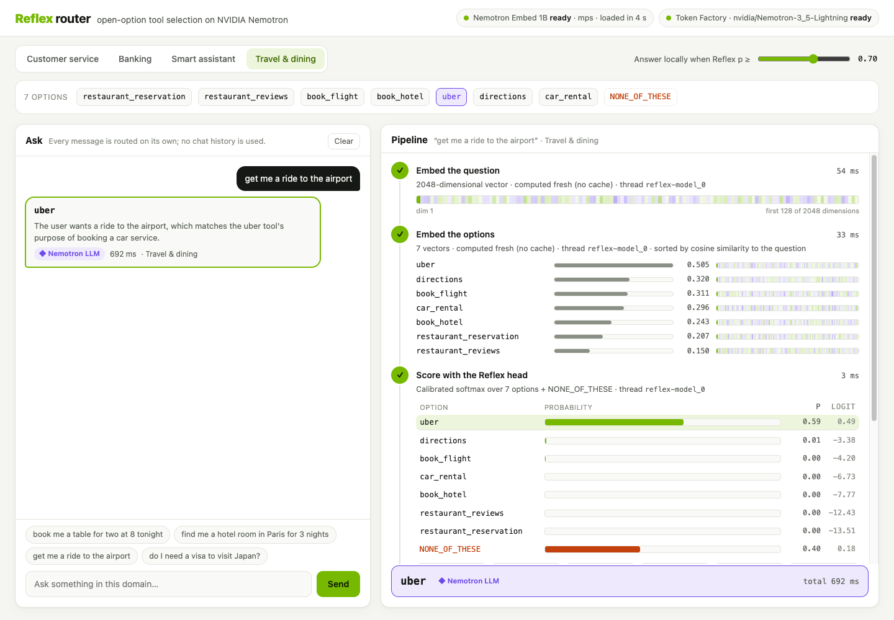

# Reflex: a fast tool router on NVIDIA Nemotron

Agents have to map each user message to one of their tools. Asking an LLM every time is slow and costs money on every request. Small classifiers are fast, but they have two flaws: they can change their answer when the same options are listed in a different order, and they must pick an option even when none fits.

Reflex is a small learned head (2.3 M parameters) on top of the frozen **NVIDIA Nemotron Embed 1B** model.
- **Open options:** it takes any list of tools written as `name: description`, including tools it never saw in training.
- **Explicit "none":** it either picks a tool or answers `NONE_OF_THESE`.
- **Order-free:** shuffling the list never changes its answer.

It runs locally and routes a message in about 50–120 ms. Requests it is unsure about go to a **Nemotron LLM**, which either picks a tool or proposes the tool that is missing.

**Live demo:** https://knowing-hermit-hideously.ngrok-free.app. ngrok shows a one-time warning page first; click **Visit Site** to continue.



## How it works

```text
question ──► Nemotron Embed 1B (encode_query) ────┐
                                                  ├──► Reflex head ──► probabilities for each tool + NONE_OF_THESE
tools    ──► Nemotron Embed 1B (encode_document) ─┘
                                                           │
                         best tool with p ≥ threshold ─────┼──► answer locally
                         NONE_OF_THESE or p < threshold ───┴──► Nemotron LLM: pick a tool, or suggest the missing one
```

The Reflex head has two parts:

- **Tool scorer.** The same small network scores every tool against the question and a summary of the whole list. The summary is an average, so the order of the list cannot matter.
- **`NONE_OF_THESE` score.** It comes from six numbers that describe the tool scores, such as the best score and the gap between the top two. It does not read the question vector itself. This helps it say "none of these fit" for tools it has never seen.

The head is trained in three steps. In step 2, some training labels are held back to play the part of unseen tools, so the `NONE_OF_THESE` score learns what a list of unfamiliar tools looks like. Details, diagrams and everything that was tried are in [reflex_model.md](reflex_model.md). The architecture is drawn in [docs/figures/reflex_v3_architecture.svg](docs/figures/reflex_v3_architecture.svg).

## Results

The data is CLINC150 and BANKING77. Every set offers 5 or 10 options, and 45 of the 227 labels are held out of training entirely. All numbers are on the validation split, as the mean of five training runs with different random seeds. The test split has not been used.

| | Reflex v3 | Cosine similarity | Order-sensitive head |
|---|---|---|---|
| Accuracy (seen labels and out-of-scope messages) | **90.2%** | 76.4% | 81.9% |
| Correct option ranked first, unseen label | **93.6%** | | |
| Answer missing, only similar options offered, unseen label: says none fits | **74.0%** | | |
| `NONE_OF_THESE` F1 | **92.7%** | | |
| Answer changes when the list is shuffled (10 shuffles per set) | **never** | never | 26.8% of sets |

When the correct option is an unseen label, Reflex picks it 80.8% of the time. It ranks that option first more often (93.6%), but then sometimes leans towards `NONE_OF_THESE`. Those borderline cases are the ones the LLM fallback handles. Full results are in [checkpoints/v3/REPORT.md](checkpoints/v3/REPORT.md).

## NVIDIA models

| Model | Role |
|---|---|
| [`nvidia/Nemotron-3.5-Embed-1B-BF16`](https://huggingface.co/nvidia/Nemotron-3.5-Embed-1B-BF16) | Frozen encoder. Questions use `encode_query`; tools use `encode_document` on `"name: description"`. Runs on CUDA, Apple MPS or CPU. |
| `nvidia/Nemotron-3_5-Lightning` on [Nebius Token Factory](https://tokenfactory.nebius.com) | Fallback router in the demo. It gets the request and the tool list, and replies in JSON: a tool, or `none` plus a suggested new tool. |

On a MacBook Pro (M4 Max), Reflex uses 3.4 GB of GPU memory. A request answered locally takes about 50–120 ms, including fresh embeddings of the question and every tool.

### Nebius Token Factory

The LLM fallback is a runtime call to the Token Factory inference API: the OpenAI-compatible `POST /v1/chat/completions` at `https://api.tokenfactory.nebius.com/v1`.
- **When it runs:** only when Reflex answers `NONE_OF_THESE`, or when its best tool is below the confidence threshold. Confident requests never leave the machine.
- **Speed and cost:** thinking is turned off with `chat_template_kwargs: {"enable_thinking": false}`. A call takes about 0.5–0.7 s, with about 350 prompt tokens and 50 output tokens, which is roughly $0.00003 at Token Factory's prices.
- **Code:** `ask_llm` in [demo/app.py](demo/app.py).
- **At startup:** the demo checks the API key and the model with `GET /v1/models`.
- **Configuration:** the key is read from `NEBIUS_API_KEY` in a gitignored `.env` file; see [.env.example](.env.example).

## Quick start

Requires Python 3.10. Run everything from the repository root.

```bash
python3.10 -m venv .venv && .venv/bin/pip install -r requirements.txt
.venv/bin/python download_model.py        # Nemotron Embed 1B into models/ (2.9 GB, pinned revision, checksums verified)
```

The trained head is included in the repository at `checkpoints/v3/weights/reflex_v3.pt`.

### Run the demo

```bash
cp .env.example .env                 # then put your Token Factory key in NEBIUS_API_KEY
.venv/bin/python demo/app.py         # open http://localhost:8000
```

The demo has four domains, each with a fixed set of tools. The page shows each step as it runs:
- the question embedding;
- the tool embeddings;
- the Reflex probabilities;
- the routing decision;
- the LLM call, when there is one.

See [demo/README.md](demo/README.md).

### Score your own tools

```bash
PYTHONPATH=src .venv/bin/python src/predict.py --pretty 2>/dev/null \
  --question "what's the most I can send in one transfer?" \
  --candidate transfer_limit "Ask what the maximum amount for a single transfer is." \
  --candidate transfer_fee "Ask why a fee was charged for a transfer." \
  --candidate cancel_transfer "Cancel a transfer that was just made."
```

```python
import sys; sys.path.insert(0, "src")
from predict import ReflexPredictor

predictor = ReflexPredictor()
result = predictor.predict_one("Did my payment for order 4521 go through?", {
    "transaction_status": "Check the status of a payment or transaction.",
    "order_tracking": "Track where a shipped order is right now.",
    "talk_to_agent": "Connect the customer with a human support agent.",
})
print(result["answer"], result["probability"])
```

Batch scoring from JSONL files and all command-line options are covered in [examples/README.md](examples/README.md).

### Tests

```bash
.venv/bin/python -m pytest -q
```

### Retrain

```bash
.venv/bin/python download_datasets.py
.venv/bin/python src/prepare_data.py --config config.yaml
.venv/bin/python src/embed.py --config config.yaml
.venv/bin/python src/build_candidates.py --config config.yaml
.venv/bin/python src/train.py --config config.yaml --heads reflex_v3
```

[checkpoints/v3/MANIFEST.json](checkpoints/v3/MANIFEST.json) records the SHA-256 of every input and output, and the package versions.

## Repository layout

| Path | Contents |
|---|---|
| `src/` | Data preparation, embedding, models (`models.py`), training, evaluation, and the predictor (`predict.py`) |
| `demo/` | The web demo: FastAPI server, domains and tools, a single-page UI |
| `checkpoints/v1` – `v3/` | Report, config, metrics and figures for each version, plus the v3 weights |
| `examples/` | Example requests for `predict.py` |
| `docs/figures/` | Architecture diagrams and the demo screenshot |
| `data/` | CLINC150 and BANKING77, raw and processed. `data/raw/` also holds API-Bank and Typed Decisions, which `download_datasets.py` fetches but training does not use. |
| `tests/` | Data, order-invariance and predictor tests |

## Limitations

- When the correct tool was never seen in training, Reflex picks it about 81% of the time. When unsure, it leans towards `NONE_OF_THESE`, and such cases go to the LLM.
- Tools whose descriptions sound alike are easy to confuse. Clear one-line descriptions work best.
- Reflex was trained on lists of 5 and 10 options and works best near those sizes.

## Credits

- **CLINC150:** Larson et al., "An Evaluation Dataset for Intent Classification and Out-of-Scope Prediction", EMNLP 2019. CC BY 3.0.
- **BANKING77:** Casanueva et al., "Efficient Intent Detection with Dual Sentence Encoders", NLP4ConvAI 2020. CC BY 4.0.
- **Typed Decisions:** [LocalLLaMA/typed-decisions](https://huggingface.co/datasets/LocalLLaMA/typed-decisions) on Hugging Face. Apache-2.0.
- **API-Bank:** Li et al., "API-Bank: A Comprehensive Benchmark for Tool-Augmented LLMs", EMNLP 2023. [liminghao1630/API-Bank](https://huggingface.co/datasets/liminghao1630/API-Bank) on Hugging Face.
- **Nemotron Embed 1B:** NVIDIA, under the [OpenMDW 1.1](https://openmdw.ai/license/1-1/) license. It is downloaded by `download_model.py`, not included in this repository.

## License

The code is licensed under the [Apache License 2.0](LICENSE). The datasets and the Nemotron model keep their own licenses, listed under Credits.
