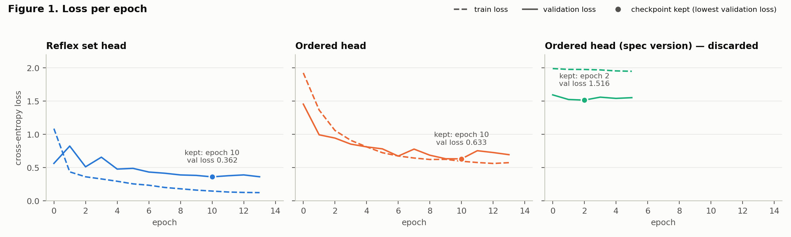
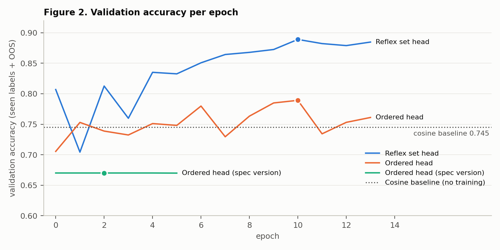
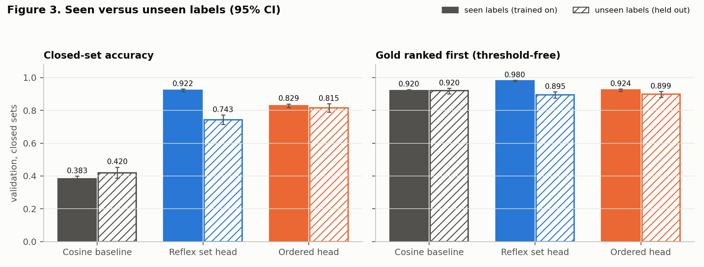
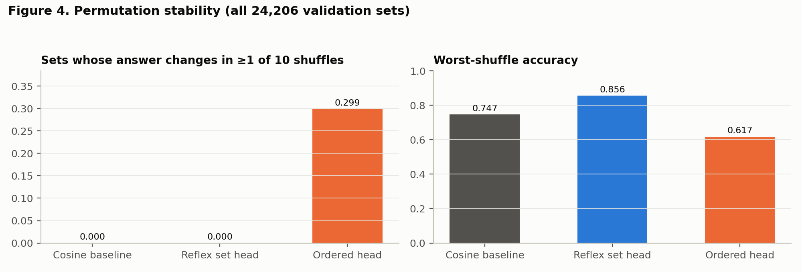

# Reflex v1 — Checkpoint Report

| | |
|---|---|
| Version | **v1** (frozen 2026-10-20) |
| Code | git tag `v1` |
| Weights | `checkpoints/v1/weights/` (seed 17), SHA-256 in `MANIFEST.json` |
| Config | `checkpoints/v1/config.yaml` |
| Numbers | `checkpoints/v1/results/metrics.json`, regenerated by `python checkpoints/v1/analysis.py --seeds 17 18 19 20 21` |
| Encoder | `nvidia/Nemotron-3.5-Embed-1B-BF16`, revision `c0f2e8ab` (frozen) |
| Evaluation split | **validation only.** The test split has not been read by any model or analysis. |

## Abstract

Option selectors that read candidates in order can change their answer when the list is shuffled, and they are often forced to pick an option even when none is correct. Reflex scores a text against a set of candidate actions using frozen Nemotron embeddings and a small Deep Sets head. The head scores every candidate with the same network and summarizes the set with an order-free mean, and it has an explicit `NONE_OF_THESE` output.

On CLINC150 and BANKING77 validation sets (19,370 candidate sets, 3,295 texts), v1 results are as follows:
- **Order invariance (exact):** shuffling the candidates never changed Reflex's answer. A matched order-sensitive head changed its answer on 29.9% of sets within 10 shuffles, and its worst-shuffle accuracy fell from 77.9% to 61.7%.
- **Accuracy:** Reflex reaches 85.5 ± 3.7% across five seeds, against 78.3 ± 0.9% for the order-sensitive head and 74.5% for a tuned cosine-similarity baseline.
- **Rejecting incomplete sets:** Reflex has the best `NONE_OF_THESE` F1 (88.8 ± 3.1) and calibrates well (ECE 0.019 after temperature scaling).
- **Main weakness, labels never seen in training:** closed-set accuracy drops to 77.1 ± 3.7%, no better than the order-sensitive head. Its threshold-free ranking (89.7%) falls below plain cosine similarity (92.0%), which shows the head partly memorizes the training labels.

v1 therefore supports the invariance and rejection claims on seen labels, and does not yet support an open-set (unseen-label) claim.

## 1. Claims and status

| # | Claim | v1 evidence | Status |
|---|---|---|---|
| C1 | Reflex's decision does not depend on candidate order | 0 answer flips in 242,060 shuffled evaluations; largest probability change < 5 × 10⁻⁷ (§4.5) | **Supported** |
| C2 | An order-sensitive selector is unstable under shuffling | Ordered head: 11.9% flips per shuffle; 29.9% of sets flip at least once in 10 shuffles; worst-shuffle accuracy −16.2 points (§4.5) | **Supported** |
| C3 | Reflex selects more accurately than the baselines | +10.0 points [9.3, 10.7] over the ordered head and +14.4 [13.7, 15.0] over cosine (seed 17); five-seed means 85.5 vs 78.3 vs 74.5 (§4.1, §4.8) | **Supported on seen labels** |
| C4 | Reflex rejects incomplete option sets (`NONE_OF_THESE`) | F1 88.8 ± 3.1 against 83.5 ± 0.7 for the ordered head; but when only similar labels remain for an unseen gold label, both heads are near 50% (§4.2, §4.4) | **Partially supported** |
| C5 | Reflex generalizes to labels never seen in training | Closed accuracy 77.1 ± 3.7 against 78.8 ± 1.7 for the ordered head; ranking below cosine (§4.4) | **Not supported in v1** |
| C6 | Confidence is good enough to route uncertain cases to an LLM | ECE 0.019 after temperature scaling; the router itself is not yet built (§4.6) | **Prerequisite met; routing untested** |

## 2. Experimental setup

### 2.1 Data

CLINC150 (150 intents, 10 domains, native out-of-scope examples) and BANKING77 (77 fine-grained banking intents) are used with their official splits. BANKING77 has no validation split, so a stratified 10% of its official training data is used (seed 17).

**Label holdout.** To test generalization to new actions, 20% of each dataset's labels are held out of training (seed 17): 30 of 150 CLINC intents (3 from each domain) and 15 of 77 BANKING categories. Their training examples are removed, and they never appear as candidates during training. They do appear in validation and test.

| Split | CLINC150 seen | CLINC150 unseen | CLINC150 out-of-scope | BANKING77 seen | BANKING77 unseen |
|---|---|---|---|---|---|
| train | 12,000 | 0 | 100 | 7,159 | 0 |
| validation | 2,400 | 600 | 100 | 795 | 206 |
| test (unread) | 3,600 | 900 | 1,000 | 2,480 | 600 |

**Label text.** A candidate is represented only by its label name exactly as the source writes it (for example `card_arrival`). Neither dataset provides descriptions, and none were written.

### 2.2 Candidate sets

Each item is (text, a shuffled list of K ∈ {5, 10} candidate labels from the same dataset, target). The target is the gold candidate's position, or `NONE_OF_THESE`, which is always an extra output and never a list entry. The gold label's position is uniformly random.

**Training: 288,885 sets.** A new set is drawn for every training text in each of 15 epochs, using seen labels only:
- 30% of sets remove the gold label (`open_set_fraction`);
- independently, 50% draw their negatives from the gold label's 20 most similar seen labels by label-embedding cosine (`hard_negative_fraction`);
- the 100 CLINC out-of-scope training texts get random candidates with target NONE.

The resulting mix is: closed 35.0%, closed with similar-label negatives 34.6%, gold removed with random negatives 14.9%, gold removed with similar-label negatives 14.9%, natural out-of-scope 0.5%.

**Validation: 24,206 sets; test: 47,480 sets.** These are fixed. Every example gets each variant at both K:
- `closed`: gold plus K−1 random negatives;
- `gold_removed_random`: K random negatives;
- `gold_removed_hard`: the K labels most similar to gold;
- `natural_oos`: CLINC out-of-scope texts with K random labels.

Every method sees identical sets.

### 2.3 Encoder

`nvidia/Nemotron-3.5-Embed-1B-BF16` (revision `c0f2e8ab`, `Mistral3Model` backbone, mean pooling, L2-normalized, 2,048 dimensions) runs locally with Sentence Transformers 6.1.0 in BF16 with PyTorch's SDPA attention, up to 512 tokens. Texts are encoded with `encode_query` and label names with `encode_document`, which add the model's `query: ` and `passage: ` prompts. Vectors are re-normalized in float32.

The encoder is frozen; embeddings are computed once (31,928 unique texts, 226 unique label names) and cached.

Checks:
- encoding the same batch twice gives identical output;
- in float32, a text encoded alone and within a padded batch agree to cosine 1.00000, so padding does not leak;
- BF16 results drift slightly with batch composition (cosine ≥ 0.995).

### 2.4 Models

All models map a text embedding *s* and candidate embeddings *c₁…c_K* (padded to 10, with a mask) to K+1 scores. Padded slots get −∞.

**Cosine baseline** (no trainable parameters). Each candidate scores zᵢ = s·cᵢ; the NONE score is a threshold τ fitted on validation (τ = 0.447).

**Reflex set head** (2,950,914 parameters, hidden size h = 256):

```text
fᵢ = [s, cᵢ, s⊙cᵢ, |s−cᵢ|]                    ∈ ℝ^8192
hᵢ = φ(fᵢ)                                     φ: Linear(8192,h)–ReLU–Linear(h,h)–ReLU   (shared by all i)
m  = mean of hᵢ over real candidates           (order-free set summary)
zᵢ = ρ([hᵢ, m])                                ρ: Linear(2h,h)–ReLU–Linear(h,1)           (shared by all i)
z_NONE = ψ([ReLU(W s), m])                     ψ: Linear(2h,h)–ReLU–Linear(h,1)
p = softmax(z₁, …, z_K, z_NONE)
```

Because φ and ρ are shared and m is a mean, the output is permutation-equivariant: shuffling the candidates shuffles their scores the same way and leaves z_NONE unchanged.

**Ordered head** (16,321,803 parameters). This is a Laya-style reproduction, not official Laya code. Each slot gets the same comparison features as Reflex, gᵢ = [cᵢ, s⊙cᵢ, |s−cᵢ|]. These are concatenated in list order, x = [s, g₁, …, g₁₀] ∈ ℝ^63,488, and passed through Linear(63488,h)–ReLU–Linear(h,h)–ReLU–Linear(h,11). Each position has its own weights, so the model is order-sensitive by construction. The only difference from Reflex is slot-specific versus shared weights.

**Negative result: the specified ordered head.** `reflex_model.md` specifies an MLP over raw concatenated embeddings x = [s, c₁, …, c₁₀] ∈ ℝ^22,528 (5,836,043 parameters). With identical data, seed and optimizer it never learned to compare the text with the options. Training loss went from 1.990 to 1.949 over 6 epochs, and it predicted NONE for every validation set. Its accuracy of 67.0% is exactly the share of NONE targets (Figure 1, right; `results/ordered_head_spec_version_log.json`). An MLP cannot recover the dot product s·cᵢ from concatenated inputs at this data scale, so the feature-matched version above is used as the order-sensitive comparator.

### 2.5 Training, model selection and calibration

| | |
|---|---|
| Loss | cross-entropy over K+1 outputs |
| Optimizer | AdamW, learning rate 10⁻³, weight decay 0.01, batch size 256 |
| Schedule | up to 15 epochs (a fresh candidate set per text each epoch); early stopping with patience 3 on validation loss; best checkpoint restored |
| Seeds | v1 weights use seed 17; seeds 17–21 are used for variance (§4.8). The seed changes initialization and batch order; candidate sets are fixed (built with seed 17). Both heads see identical batches. |
| Selection data | the 19,370 validation sets with seen labels or natural out-of-scope texts (about two-thirds have target NONE). The 4,836 unseen-label validation sets were used for no decision. |
| Calibration | one temperature per method minimizing validation NLL; the cosine threshold maximizes validation accuracy |
| Hardware | Apple M4 Max, PyTorch MPS, float32 for heads; 22.8 s wall time to train both heads |
| Determinism | retraining with the same seed reproduces `training_log.json` byte for byte on this machine |

### 2.6 Metrics and statistics

- **Accuracy:** the argmax over K+1 outputs equals the target (a candidate position or NONE).
- **NONE precision, recall, F1:** NONE is the positive class. **False-accept rate** = 1 − NONE recall, the share of sets with no correct option where an option was still picked.
- **Gold ranked first (threshold-free):** on closed sets, the gold candidate has the highest candidate score, ignoring NONE.
- **AUROC:** threshold-free separation of closed sets from gold-removed sets, using the score max_i zᵢ − z_NONE.
- **Permutation stability:** each validation set is shuffled 10 times; predictions are mapped back to candidate identities.
  - *flip rate*: the share of (set, shuffle) pairs whose answer differs from the original order's answer;
  - *worst-shuffle accuracy*: the share of sets correct under the original order and all 10 shuffles;
  - *max probability change*: the largest change, over the 10 shuffles, in the calibrated probability of the original answer.
- **Calibration:** NLL, and expected calibration error (ECE) over 15 equal-width bins after temperature scaling.
- **Confidence intervals:** 95% percentile intervals from a 1,000-resample *cluster* bootstrap that resamples texts rather than sets, because each text contributes up to 6 correlated sets. Paired differences are bootstrapped the same way.

Unless stated otherwise, §4 reports the frozen v1 weights (seed 17) on seen-label and natural out-of-scope validation sets. Section 4.8 gives five-seed means, which **should be preferred when quoting performance**.

## 3. Training dynamics





- **Reflex.** Training loss falls from 1.087 to 0.125. Validation loss is unstable in epochs 0–3 (0.56 → 0.83 → 0.51 → 0.66), then declines smoothly to a minimum of **0.362 at epoch 10** and plateaus (0.379, 0.391, 0.363). Early stopping ends training at epoch 13. Meanwhile the gap between training and validation loss widens from 0.21 to 0.24: the head has saturated and is starting to overfit. The early instability is consistent with a learning rate that is too high, and with the large seed-to-seed variance in §4.8.
- **Ordered head.** Training loss falls from 1.92 to about 0.57; validation loss reaches a minimum of **0.633 at epoch 10**, with swings of ±0.1 between epochs. Training and validation loss stay close together, so this head is limited by capacity and inductive bias (it must learn the same comparison once per position) rather than by overfitting.
- **Ordered head, spec version.** Flat; it never left the predict-NONE solution.

## 4. Results (validation)

### 4.1 Accuracy by set type

Accuracy in % with 95% CI, seen labels plus natural out-of-scope, seed 17.

| Set type | n sets | Cosine | **Reflex** | Ordered |
|---|---|---|---|---|
| closed | 6,390 | 38.3 [36.7, 40.0] | **92.2** [91.4, 93.1] | 82.9 [81.8, 84.0] |
| gold_removed_hard | 6,390 | **86.6** [85.5, 87.7] | 79.5 [78.1, 80.8] | 65.5 [63.9, 67.1] |
| gold_removed_random | 6,390 | **97.9** [97.5, 98.2] | 94.8 [94.2, 95.3] | 87.8 [86.9, 88.5] |
| natural_oos | 200 | **100.0** [100.0, 100.0] | 94.5 [91.0, 97.5] | 97.0 [94.5, 99.0] |
| **all** | 19,370 | 74.5 [73.9, 75.1] | **88.9** [88.3, 89.5] | 78.9 [78.2, 79.6] |

Paired differences on all sets: Reflex − Ordered = **+10.0** [9.3, 10.7] points; Reflex − Cosine = **+14.4** [13.7, 15.0] points.

Cosine's high scores on the gold-removed and out-of-scope rows reflect its threshold, not better discrimination. The threshold was fitted on a validation mix that is two-thirds NONE, so cosine rejects almost every input, and 98.8% of its closed-set errors are false rejections. The threshold-free comparison in §4.3 removes this effect.

### 4.2 Rejecting incomplete option sets (`NONE_OF_THESE`), %

| | Cosine | **Reflex** | Ordered |
|---|---|---|---|
| Precision | 75.5 | **96.3** | 92.0 |
| Recall | **92.4** | 87.2 | 77.0 |
| F1 | 83.1 | **91.5** | 83.8 |
| False-accept rate | **7.6** | 12.8 | 23.0 |
| Closed-set errors that are false rejections | 98.8 | 88.5 | 80.0 |

Reflex's NONE predictions are precise (96.3%). Most of its remaining closed-set errors are false rejections rather than wrong picks.

### 4.3 Threshold-free comparison

| Metric | Labels | Cosine | **Reflex** | Ordered |
|---|---|---|---|---|
| Gold ranked first, closed sets (%) | seen | 92.0 [91.2, 92.8] | **98.0** [97.6, 98.4] | 92.4 [91.7, 93.1] |
| Gold ranked first, closed sets (%) | unseen | **92.0** [90.2, 93.5] | 89.5 [87.5, 91.3] | 89.9 [87.9, 91.5] |
| AUROC, present vs hard-removed | seen | 0.693 | **0.940** | 0.854 |
| AUROC, present vs hard-removed | unseen | 0.696 | 0.741 | **0.811** |
| AUROC, present vs random-removed | seen | 0.872 | **0.983** | 0.942 |
| AUROC, present vs random-removed | unseen | 0.887 | 0.910 | **0.923** |

Cosine ranks the gold label first equally often for seen and unseen labels (92.0% both), so **the frozen embeddings carry a signal that transfers to new labels**. Both trained heads improve on that signal for seen labels and fall below it for unseen labels.

### 4.4 Labels never seen in training

Accuracy in %, 95% CI. Unseen-label sets come from 806 texts.

| Set type | Labels | n sets | Cosine | Reflex | Ordered |
|---|---|---|---|---|---|
| closed | seen | 6,390 | 38.3 [36.7, 40.0] | **92.2** [91.4, 93.1] | 82.9 [81.8, 84.0] |
| closed | unseen | 1,612 | 42.0 [38.6, 45.4] | 74.3 [71.4, 77.2] | **81.5** [79.0, 84.1] |
| gold_removed_hard | seen | 6,390 | **86.6** [85.5, 87.7] | 79.5 [78.1, 80.8] | 65.5 [63.9, 67.1] |
| gold_removed_hard | unseen | 1,612 | **84.8** [82.5, 87.0] | 52.0 [48.7, 55.3] | 53.6 [50.6, 56.9] |
| gold_removed_random | seen | 6,390 | **97.9** [97.5, 98.2] | 94.8 [94.2, 95.3] | 87.8 [86.9, 88.5] |
| gold_removed_random | unseen | 1,612 | **98.8** [98.1, 99.4] | 90.5 [89.0, 92.1] | 86.9 [85.2, 88.7] |



For the seed-17 weights, Reflex − Ordered on unseen closed sets is **−7.2** [−9.6, −5.2] points. Averaged over five seeds the gap shrinks to −1.7 points (77.1 vs 78.8, §4.8). Either way, Reflex does not beat the order-sensitive head on unseen labels. When the gold label is unseen and the remaining candidates are similar labels, both heads are close to a coin flip at answering NONE.

### 4.5 Permutation stability

All 24,206 validation sets (including unseen labels), 10 shuffles each.

| | Cosine | **Reflex** | Ordered |
|---|---|---|---|
| Answer flip rate per shuffle (%) | 0.0 | **0.0** | 11.9 |
| Sets with ≥1 flip in 10 shuffles (%) | 0.0 | **0.0** | 29.9 |
| Accuracy, original order (%) | 74.7 | **85.6** | 77.9 |
| Worst-shuffle accuracy (%) | 74.7 | **85.6** | 61.7 |
| Max probability change, mean over sets | 0.000 | **0.000** | 0.203 |
| Max probability change, worst set | 0.000 | **0.000** | 0.940 |



In the unit test on the trained weights, Reflex's scores mapped back to candidate identities change by at most **3.8 × 10⁻⁶** under shuffling, below the spec's 10⁻⁵ requirement. The ordered head's change by up to 19.9. Shuffling costs the ordered head 16.2 accuracy points in the worst case.

### 4.6 Calibration

| | Cosine | **Reflex** | Ordered |
|---|---|---|---|
| Temperature | 0.078 | 1.514 | 0.933 |
| NLL before → after | 1.861 → 0.740 | 0.362 → **0.320** | 0.633 → 0.631 |
| ECE after scaling | 0.082 | **0.019** | 0.060 |

Reflex is overconfident before scaling (temperature above 1) and well calibrated afterwards. Cosine needs a low temperature because raw cosine scores span a narrow range.

### 4.7 By dataset and list size

Accuracy in %, seen labels plus natural out-of-scope, seed 17.

| Subset | Cosine | **Reflex** | Ordered |
|---|---|---|---|
| CLINC150, all types | 75.2 | **88.9** | 80.7 |
| CLINC150 closed | 32.6 | **92.7** | 84.4 |
| CLINC150 gold_removed_hard | **92.3** | 78.0 | 65.3 |
| CLINC150 gold_removed_random | **99.7** | 95.6 | 91.7 |
| BANKING77, all types | 72.6 | **89.0** | 73.5 |
| BANKING77 closed | 55.8 | **90.9** | 78.4 |
| BANKING77 gold_removed_hard | 69.3 | **84.0** | 66.2 |
| BANKING77 gold_removed_random | **92.6** | 92.2 | 75.8 |
| 5 candidates | 75.0 | **90.6** | 81.5 |
| 10 candidates | 74.1 | **87.2** | 76.4 |

Reflex performs equally on both datasets. The ordered head falls behind on BANKING77, whose 77 labels are fine-grained and semantically close. Going from 5 to 10 candidates costs every method 1–5 points.

### 4.8 Seed variance (seeds 17–21)

Values in %, mean ± standard deviation over 5 training runs on the same candidate sets.

| Metric | Reflex | Ordered | Reflex per seed (17, 18, 19, 20, 21) |
|---|---|---|---|
| Accuracy, all (seen + out-of-scope) | **85.5 ± 3.7** | 78.3 ± 0.9 | 88.9, 89.2, 80.4, 84.8, 84.3 |
| Closed accuracy, seen | **89.3 ± 1.8** | 79.2 ± 2.4 | 92.2, 87.9, 89.7, 88.2, 88.7 |
| Closed accuracy, unseen | 77.1 ± 3.7 | **78.8 ± 1.7** | 74.3, 73.0, 82.4, 78.0, 77.7 |
| Gold ranked first, unseen | **89.7 ± 0.3** | 88.4 ± 0.9 | 89.5, 89.9, 90.1, 89.4, 89.5 |
| AUROC hard-removed, unseen (×100) | 78.2 ± 2.6 | **79.9 ± 0.8** | 74.1, 77.3, 80.8, 79.6, 79.1 |
| NONE F1 | **88.8 ± 3.1** | 83.5 ± 0.7 | 91.5, 92.0, 84.4, 88.4, 87.9 |

Ordered-head accuracy per seed: 78.9, 78.3, 78.6, 76.9, 79.0. Cosine has no seed dependence (74.5).

**The v1 checkpoint (seed 17) is one of the two best of the five seeds**, so single-seed numbers overstate Reflex's typical performance by about 3 points. Reflex is roughly four times more seed-sensitive than the ordered head (standard deviation 3.7 vs 0.9). Most of that variance is in where it places the NONE boundary: its ranking metric is stable (±0.3) while accuracy and NONE F1 are not. Reflex's advantage on seen labels survives across seeds: its worst seed (80.4) still beats the ordered head's best (79.0).

## 5. Analysis: why Reflex underperforms on unseen labels

The diagnostics below use the seed-17 weights.

**Average Reflex score at equal cosine similarity:**

| Cosine bin | Gold, seen | Gold, unseen | Cosine bin | Negative, seen | Negative, unseen |
|---|---|---|---|---|---|
| ≤ 0.3 | +0.34 | **−5.01** | ≤ 0.2 | −14.81 | −14.93 |
| 0.3–0.4 | +2.10 | −0.47 | 0.2–0.3 | −11.74 | −9.98 |
| 0.4–0.5 | +2.90 | +2.32 | 0.3–0.4 | −9.41 | −6.50 |
| > 0.5 | +3.51 | +3.59 | > 0.4 | −6.56 | **−2.71** |

Golds are from closed sets; negatives are from gold-removed random sets with a seen gold label.

**Errors on unseen closed sets:** 414 of 1,612 sets. **91.5% are false rejections** (NONE beat the gold); 8.5% picked a wrong label, and 82.9% of those wrong labels were seen labels.

**Interpretation.**
1. The embeddings are not the bottleneck: cosine ranks unseen and seen golds equally well (§4.3).
2. For seen labels, the head has learned label-specific associations beyond what the label name provides. It lifts seen golds even at low cosine (for example "how would you say fly in italian" → `translate`, where cosine ranks `flight_status` first) and pushes seen negatives far down. This yields 98.0% ranking on seen labels.
3. For unseen labels it has no such associations. Unseen golds with low or moderate cosine score far below NONE and are rejected; unseen negatives are not pushed down, so the model accepts similar-but-wrong options when the gold is missing.
4. Contributing factors:
   - **Only 182 distinct label vectors in training.** The candidate side of the 8,192-input first layer sees only 182 points, so a per-label lookup is easier to learn than a general similarity function.
   - **Raw cᵢ in the features gives the network a direct label-identity input.**
   - **The NONE score is calibrated to seen-label score levels.**
   - **Model selection uses seen labels only, so it rewards memorization.**

These are hypotheses consistent with the diagnostics. v1 does not isolate them with controlled experiments.

## 6. Threats to validity and limitations

- **Validation only.** Every number comes from validation data. Early stopping, temperatures and the cosine threshold were fitted on its seen-label and out-of-scope rows, so those numbers are optimistic. The unseen-label rows were not used for any decision. The test split is untouched and should be evaluated once, for all versions together, at the end.
- **Seed variance.** Reflex varies ±3.7 points across seeds (§4.8). Quote five-seed means, and treat the seed-17 checkpoint as representative of the method, not of its typical accuracy.
- **Baseline construction.** The ordered head is a Laya-style reproduction with Reflex's comparison features, not official Laya code; the spec's version failed to train (§2.4). The cosine threshold objective (accuracy on a NONE-heavy mix) biases it toward rejection; an F1-based threshold would be fairer.
- **Label text.** Only raw label names are used. This limits the cosine baseline and probably limits transfer to unseen labels; results with natural-language descriptions could differ.
- **Synthetic open-set variants.** `gold_removed_*` sets are constructed by deleting the gold label. Only the 200 CLINC out-of-scope validation sets are naturally occurring.
- **Hardware.** All runs are on Apple MPS. A CUDA (A100) rerun is expected to be close but not bit-identical.
- **Not yet measured:** the direct-LLM comparison, the router's coverage and latency, and end-to-end latency.

## 7. Deviations from `reflex_model.md`

| Spec | v1 | Reason |
|---|---|---|
| Ordered head over `[s, c₁…c₁₀]` | Ordered head over `[s, g₁…g₁₀]` with gᵢ = [cᵢ, s⊙cᵢ, \|s−cᵢ\|] | The spec version never learned (§2.4) |
| Readable label descriptions | Raw label names only | Project decision: labels only from the source |
| No unseen-label protocol | 20% of labels held out of training | To test the open-set claim (C5) |
| Candidate sets built in `prepare_data.py` | Separate `build_candidates.py` after embedding | Hard negatives need label embeddings |
| Optional hard-negative training | 50% of training sets use similar-label negatives | Needed for meaningful hard rejection |
| `embed.py --resume` | Automatic resume; `--force` re-embeds | Simpler; same behavior |
| Python 3.12, CUDA | Python 3.10; device auto-selected (MPS here, CUDA on A100) | Project environment |
| Batch size 4 | Per device: 128 CUDA, 32 MPS, 8 CPU | Throughput (about 270 texts/s on MPS) |

## 8. Reproducing v1

```bash
git checkout v1
python3.10 -m venv .venv && .venv/bin/pip install -r requirements.txt
python download_datasets.py
python download_model.py                              # pinned revision, SHA-256 verified
python src/prepare_data.py --config config.yaml
python src/embed.py --config config.yaml
python src/build_candidates.py --config config.yaml
python src/train.py --config config.yaml              # reproduces checkpoints/v1/weights on the same hardware
python -m pytest                                      # 9 tests
python checkpoints/v1/analysis.py --seeds 17 18 19 20 21
```

`MANIFEST.json` lists the SHA-256 of every input (raw data, standardized splits, candidate sets, embeddings), the config, the weights, and the package versions (Python 3.10.22, torch 2.14.1, transformers 5.16.1, sentence-transformers 6.1.0).

## 9. Candidate directions for v2

Listed for traceability; not yet decided.
1. Dropout, including dropout on the input features.
2. Score candidates as cosine plus a learned correction, and give the NONE output order-free cosine statistics.
3. Select models on held-out *training* labels to reward generalization.
4. Noise on label vectors during training.
5. Remove raw *s* and *cᵢ* from the per-candidate features.
6. A lower learning rate (to reduce seed variance), and an F1-based cosine threshold.

## Appendix A. Per-epoch log (seed 17)

| Epoch | Reflex train | Reflex val | Reflex val acc | Ordered train | Ordered val | Ordered val acc |
|---|---|---|---|---|---|---|
| 0 | 1.087 | 0.564 | 0.807 | 1.925 | 1.456 | 0.706 |
| 1 | 0.437 | 0.825 | 0.704 | 1.367 | 0.994 | 0.753 |
| 2 | 0.363 | 0.513 | 0.813 | 1.060 | 0.945 | 0.739 |
| 3 | 0.331 | 0.658 | 0.760 | 0.911 | 0.854 | 0.732 |
| 4 | 0.296 | 0.479 | 0.835 | 0.813 | 0.813 | 0.751 |
| 5 | 0.257 | 0.490 | 0.833 | 0.725 | 0.783 | 0.748 |
| 6 | 0.236 | 0.434 | 0.851 | 0.676 | 0.674 | 0.780 |
| 7 | 0.203 | 0.417 | 0.864 | 0.645 | 0.779 | 0.730 |
| 8 | 0.183 | 0.391 | 0.868 | 0.623 | 0.687 | 0.763 |
| 9 | 0.163 | 0.384 | 0.873 | 0.625 | 0.634 | 0.785 |
| **10** | 0.148 | **0.362** | **0.889** | 0.597 | **0.633** | **0.789** |
| 11 | 0.134 | 0.379 | 0.882 | 0.578 | 0.755 | 0.734 |
| 12 | 0.128 | 0.391 | 0.879 | 0.564 | 0.728 | 0.753 |
| 13 | 0.125 | 0.363 | 0.885 | 0.575 | 0.695 | 0.761 |

## Appendix B. Checkpoint contents

```text
checkpoints/v1/
├── REPORT.md                 this document
├── MANIFEST.json             SHA-256 of inputs, weights and config; environment
├── config.yaml               exact configuration used
├── analysis.py               regenerates results/metrics.json, figures and MANIFEST.json
├── results/
│   ├── metrics.json          every number in §4–§5, with CIs and seed runs
│   ├── training_log.json     per-epoch losses (seed 17)
│   ├── calibration.json      cosine threshold and temperatures
│   └── ordered_head_spec_version_log.json   the discarded spec-version run
├── figures/                  fig1_loss, fig2_validation_accuracy, fig3_seen_vs_unseen, fig4_permutation_stability
└── weights/                  set_head.pt, ordered_head.pt (not in git; reproducible; hashes in MANIFEST.json)
```
