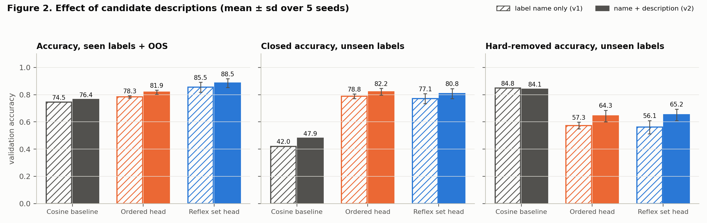
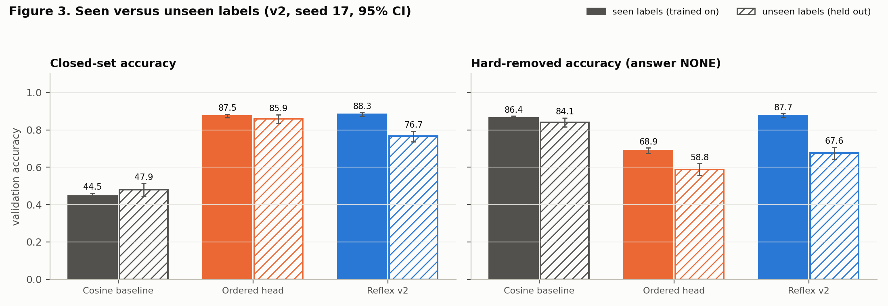
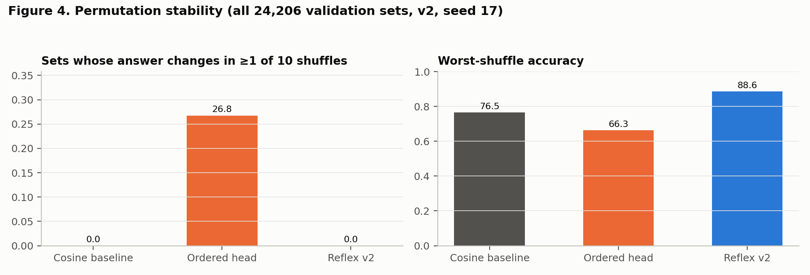
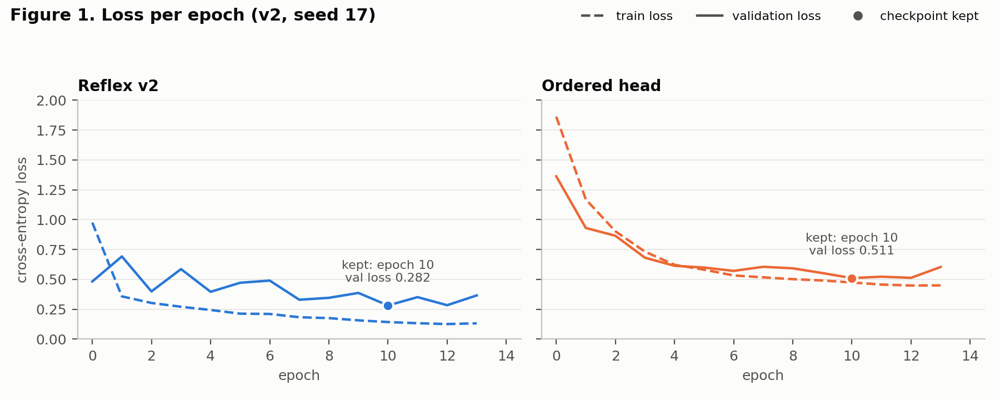

# Reflex v2 — Checkpoint Report

| | |
|---|---|
| Version | **v2** (frozen 2026-10-20); previous: [v1](../v1/REPORT.md) |
| Code | git tag `v2` |
| Weights | `checkpoints/v2/weights/` (seed 17), SHA-256 in `MANIFEST.json` |
| Config | `checkpoints/v2/config.yaml` (`candidate_text: name_description`) |
| Numbers | `checkpoints/v2/results/metrics.json`, regenerated by `python checkpoints/v2/analysis.py --seeds 17 18 19 20 21` |
| Encoder | `nvidia/Nemotron-3.5-Embed-1B-BF16`, revision `c0f2e8ab` (frozen, unchanged) |
| Evaluation split | **validation only.** The test split has still not been read. |

## Abstract

v2 changes one thing from v1: each candidate is embedded as its label name **plus a one-line description** (`card_arrival: Ask when a card that was ordered will arrive.`) instead of the bare name. The Reflex set head, the baselines, the data, the candidate sets and the training procedure are all unchanged.

Across five seeds on the same validation sets as v1, descriptions improve every method:
- **Reflex accuracy:** 85.5 ± 3.7% → **88.5 ± 3.2%**.
- **Labels held out of training:** closed-set accuracy 77.1 → **80.8%**; accuracy when the gold label is missing and only similar labels remain 56.1 → **65.2%**; the gold candidate is ranked first 89.7 → **93.3%** of the time.
- **`NONE_OF_THESE` F1:** 88.8 → **91.3**.
- **Calibration:** ECE 0.019 → **0.010** (seed 17).
- **Order invariance:** still exact, with 0 answer flips in 242,060 shuffled evaluations. The order-sensitive head flips on 26.8% of sets.
- **Comparison with the baselines on the same descriptions:** Reflex leads the ordered head by **+6.6 points** (88.5 vs 81.9) and cosine by **+12.1** (88.5 vs 76.4).

Two v1 limitations remain:
- On unseen-label closed sets Reflex is still level with the ordered head, not ahead of it (80.8 ± 3.7 vs 82.2 ± 2.5).
- Reflex remains about twice as seed-sensitive as the ordered head (sd 3.2 vs 1.5).

## 1. What changed from v1

| | v1 | v2 |
|---|---|---|
| Candidate text | raw label name: `card_arrival` | name + description: `card_arrival: Ask when a card that was ordered will arrive.` |
| Distinct candidate texts | 226 (the two `exchange_rate` labels shared one) | 227 |
| Everything else | — | unchanged: data, splits, unseen-label holdout, candidate sets (identical IDs), encoder, all three models, optimizer, schedule, seeds, model selection, calibration, metrics |

The candidate text is a config switch: `candidate_text: name` reproduces v1 exactly. In the ablation below, all five name-only Reflex runs reproduce the v1 checkpoint numbers seed for seed.

## 2. Claims and status

| # | Claim | v1 status | v2 evidence (five-seed mean ± sd unless noted) | v2 status |
|---|---|---|---|---|
| C1 | Reflex's decision does not depend on candidate order | Supported | 0 flips in 242,060 shuffled evaluations; largest probability change < 5 × 10⁻⁷ (seed 17) | **Supported** |
| C2 | An order-sensitive selector is unstable under shuffling | Supported | Ordered head: 26.8% of sets flip in ≥1 of 10 shuffles; worst-shuffle accuracy −15.0 points (seed 17) | **Supported** |
| C3 | Reflex selects more accurately than the baselines (seen labels) | Supported | 88.5 ± 3.2 vs 81.9 ± 1.5 (ordered) vs 76.4 (cosine) | **Supported** |
| C4 | Reflex rejects incomplete option sets | Partially | NONE F1 91.3 ± 2.7 vs 86.3 ± 1.2 (ordered); unseen hard-removed 65.2 ± 4.2 (v1: 56.1) | **Partially supported, improved** |
| C5 | Reflex generalizes to labels never seen in training | Not supported | Unseen closed 80.8 ± 3.7 vs 82.2 ± 2.5 (ordered); unseen ranking 93.3 vs 95.2 (cosine) | **Not supported; gap narrowed** |
| C6 | Calibrated enough to route uncertain cases to an LLM | Prerequisite met | ECE 0.010 after temperature scaling (seed 17); routing untested | **Prerequisite met** |

## 3. Method

### 3.1 Candidate descriptions

`data/label_descriptions.json` holds one sentence for each of the 227 labels. The embedded candidate text is `"{label name}: {description}"`, encoded with `encode_document` exactly as names were in v1. Examples:
- `card_arrival: Ask when a card that was ordered will arrive.`
- `pending_card_payment: Ask why a card payment is still pending.`
- `translate: Translate a word or phrase into another language.`
- `exchange_rate: Look up the exchange rate between two currencies.` (CLINC150)
- `exchange_rate: Ask what exchange rate is used to convert currencies.` (BANKING77)

**How they were written.** The project's AI coding assistant (Claude) wrote the descriptions from each label's name, and for CLINC150 its domain, only. No example texts from any split were consulted, so the descriptions for held-out labels carry no information from their examples. They were written once and not tuned against any results.

**Candidate sets are unchanged.** Hard negatives are still defined by similarity between *label-name* embeddings. Every v1 and v2 number is computed on identical candidate ID lists, and only the vectors representing the candidates differ.

### 3.2 Models and training

Identical to v1 (see [v1 §2.4–2.5](../v1/REPORT.md)):
- **Cosine baseline:** threshold refitted on validation, now 0.457.
- **Reflex set head:** Deep Sets, 2,950,914 parameters.
- **Ordered head:** 16,321,803 parameters.
- **Training:** AdamW at learning rate 10⁻³, batch size 256, up to 15 epochs, early stopping with patience 3. Selection and calibration use seen-label and natural out-of-scope validation rows only.

## 4. Results (validation)

All numbers are on the same 24,206 validation candidate sets as v1. "All" means the 19,370 seen-label and out-of-scope sets; "unseen" rows come from 806 texts whose gold label was held out of training. In the seed-17 tables:
- **Reflex v1** is the frozen v1 checkpoint (label names).
- **Reflex v2**, **Ordered** and **Cosine** use the v2 descriptions.

### 4.1 Effect of descriptions

Five seeds (17–21), mean ± sd, in %. Cosine has no seed dependence.

| Method | Candidate text | Accuracy, all | Closed, seen | Closed, unseen | Hard-removed, unseen | Gold ranked first, unseen | AUROC hard-removed, unseen ×100 | NONE F1 |
|---|---|---|---|---|---|---|---|---|
| Cosine | name (v1) | 74.5 | 38.3 | 42.0 | **84.8** | 92.0 | 69.6 | 83.1 |
| Cosine | name + description (v2) | 76.4 | 44.5 | 47.9 | **84.1** | **95.2** | 73.2 | 84.1 |
| Ordered | name (v1) | 78.3 ± 0.9 | 79.2 ± 2.4 | 78.8 ± 1.7 | 57.3 ± 2.5 | 88.4 ± 0.9 | 79.9 ± 0.8 | 83.5 ± 0.7 |
| Ordered | name + description (v2) | 81.9 ± 1.5 | 82.0 ± 3.3 | **82.2 ± 2.5** | 64.3 ± 4.2 | 92.6 ± 1.3 | **85.0 ± 0.9** | 86.3 ± 1.2 |
| Reflex | name (v1) | 85.5 ± 3.7 | 89.3 ± 1.8 | 77.1 ± 3.7 | 56.1 ± 4.9 | 89.7 ± 0.3 | 78.2 ± 2.6 | 88.8 ± 3.1 |
| **Reflex** | **name + description (v2)** | **88.5 ± 3.2** | **89.9 ± 1.8** | 80.8 ± 3.7 | 65.2 ± 4.2 | 93.3 ± 0.6 | 84.1 ± 1.6 | **91.3 ± 2.7** |

Per seed, Reflex v2 accuracy on all sets is 91.0, 90.0, 83.2, 90.4, 87.9, and closed accuracy on unseen labels is 76.7, 79.3, 84.7, 78.8, 84.7. Ordered v2 accuracy per seed is 82.2, 83.2, 82.2, 79.4, 82.5.



**Gain from descriptions** (v2 − v1, five-seed means, in points):

| Method | Accuracy, all | Closed, seen | Closed, unseen | Hard-removed, unseen | Gold ranked first, unseen | AUROC hard-removed, unseen ×100 | NONE F1 |
|---|---|---|---|---|---|---|---|
| Cosine | +1.9 | +6.1 | +5.9 | −0.7 | +3.2 | +3.6 | +1.0 |
| Ordered | +3.5 | +2.9 | +3.4 | +7.1 | +4.2 | +5.1 | +2.8 |
| Reflex | +3.0 | +0.6 | +3.7 | **+9.0** | +3.7 | **+5.9** | +2.4 |

The largest gains are on labels the heads never trained on, and on rejecting sets that contain only similar-but-wrong options. Descriptions make each candidate's meaning explicit, which matters most where a bare name like `pending_top_up` or `exchange_charge` is ambiguous.

### 4.2 Main results (seed 17)

Accuracy in % with 95% cluster-bootstrap CI, seen labels plus natural out-of-scope.

| Set type | n sets | Cosine | Ordered | Reflex v1 | **Reflex v2** |
|---|---|---|---|---|---|
| closed | 6,390 | 44.5 [42.7, 46.1] | 87.5 [86.6, 88.4] | **92.2** [91.4, 93.1] | 88.3 [87.2, 89.3] |
| gold_removed_hard | 6,390 | 86.4 [85.2, 87.5] | 68.9 [67.4, 70.4] | 79.5 [78.1, 80.8] | **87.7** [86.6, 88.8] |
| gold_removed_random | 6,390 | **97.8** [97.4, 98.1] | 89.7 [88.9, 90.4] | 94.8 [94.2, 95.3] | 96.9 [96.5, 97.3] |
| natural_oos | 200 | **100.0** [100.0, 100.0] | 98.0 [96.0, 99.5] | 94.5 [91.0, 97.5] | 98.0 [96.0, 99.5] |
| **all** | 19,370 | 76.4 [75.8, 77.0] | 82.2 [81.5, 82.8] | 88.9 [88.3, 89.5] | **91.0** [90.5, 91.5] |

Paired differences for Reflex v2 on identical sets, in points with 95% CI:

| v2 minus | All (seen + OOS) | Closed, unseen | Hard-removed, unseen |
|---|---|---|---|
| Reflex v1 | **+2.1** [1.6, 2.6] | +2.4 [−0.5, 5.1] | **+15.6** [12.7, 18.6] |
| Ordered | **+8.8** [8.2, 9.5] | **−9.2** [−11.6, −7.0] | **+8.8** [5.7, 11.8] |
| Cosine | **+14.6** [13.9, 15.3] | **+28.8** [25.6, 32.0] | −16.5 [−19.9, −13.0] |

At seed 17, Reflex v2 trades some closed-set accuracy (88.3 vs 92.2 for v1) for much better rejection of similar-but-wrong options (87.7 vs 79.5). Across five seeds, closed-set accuracy on seen labels is about the same for both (89.9 vs 89.3, §4.1). The seed-17 v1 checkpoint was one of its best draws, so the seed-17 closed-set gap overstates the trade-off.

### 4.3 Rejecting incomplete option sets (`NONE_OF_THESE`), seed 17, %

| | Cosine | Ordered | Reflex v1 | **Reflex v2** |
|---|---|---|---|---|
| Precision | 77.3 | 93.9 | **96.3** | 94.5 |
| Recall | 92.2 | 79.5 | 87.2 | **92.4** |
| F1 | 84.1 | 86.1 | 91.5 | **93.4** |
| False-accept rate | 7.8 | 20.4 | 12.8 | **7.6** |
| Closed-set errors that are false rejections | 98.9 | 84.2 | 88.5 | 93.6 |

Descriptions cut Reflex's false-accept rate from 12.8% to 7.6%, matching the reject-heavy cosine baseline (7.8%) while keeping 88.3% closed-set accuracy (cosine: 44.5%).

### 4.4 Labels never seen in training

Accuracy in %, seed 17, 95% CI.

| Set type | Labels | Cosine | Ordered | Reflex v1 | **Reflex v2** |
|---|---|---|---|---|---|
| closed | seen | 44.5 [42.7, 46.1] | 87.5 [86.6, 88.4] | **92.2** [91.4, 93.1] | 88.3 [87.2, 89.3] |
| closed | unseen | 47.9 [44.6, 51.4] | **85.9** [83.6, 88.1] | 74.3 [71.4, 77.2] | 76.7 [73.6, 79.3] |
| gold_removed_hard | seen | 86.4 [85.2, 87.5] | 68.9 [67.4, 70.4] | 79.5 [78.1, 80.8] | **87.7** [86.6, 88.8] |
| gold_removed_hard | unseen | **84.1** [81.7, 86.5] | 58.8 [55.7, 61.9] | 52.0 [48.7, 55.3] | 67.6 [64.4, 70.7] |
| gold_removed_random | seen | 97.8 [97.4, 98.1] | 89.7 [88.9, 90.4] | 94.8 [94.2, 95.3] | **96.9** [96.5, 97.3] |
| gold_removed_random | unseen | **98.5** [97.8, 99.1] | 88.1 [86.5, 90.0] | 90.5 [89.0, 92.1] | 93.2 [92.1, 94.5] |



**Average calibrated probability that a listed option is correct**, 1 − P(NONE):

| Set type | Labels | Cosine | Ordered | Reflex v1 | **Reflex v2** |
|---|---|---|---|---|---|
| closed (should be high) | seen | 0.485 | 0.873 | 0.894 | 0.853 |
| closed (should be high) | unseen | 0.500 | 0.867 | 0.763 | 0.770 |
| gold_removed_hard (should be low) | seen | 0.304 | 0.422 | 0.280 | 0.186 |
| gold_removed_hard (should be low) | unseen | 0.330 | 0.505 | 0.528 | 0.389 |
| gold_removed_random (should be low) | seen | 0.123 | 0.205 | 0.103 | 0.065 |
| gold_removed_random (should be low) | unseen | 0.116 | 0.220 | 0.159 | 0.109 |

Reflex v2 errs on 376 of 1,612 unseen closed sets (v1: 414). Of those errors, 94.4% are false rejections and 5.6% are wrong labels.

### 4.5 Threshold-free comparison (seed 17)

| Metric | Labels | Cosine | Ordered | Reflex v1 | **Reflex v2** |
|---|---|---|---|---|---|
| Gold ranked first, closed (%) | seen | 95.4 [94.8, 96.0] | 95.3 [94.8, 95.9] | 98.0 [97.6, 98.4] | **98.1** [97.8, 98.5] |
| Gold ranked first, closed (%) | unseen | **95.2** [93.9, 96.4] | 94.2 [92.8, 95.4] | 89.5 [87.5, 91.3] | 93.1 [91.4, 94.6] |
| AUROC, present vs hard-removed | seen | 0.740 | 0.897 | 0.940 | **0.947** |
| AUROC, present vs hard-removed | unseen | 0.732 | **0.864** | 0.741 | 0.821 |
| AUROC, present vs random-removed | seen | 0.893 | 0.962 | **0.983** | **0.983** |
| AUROC, present vs random-removed | unseen | 0.906 | **0.949** | 0.910 | 0.940 |

### 4.6 Permutation stability (all 24,206 validation sets, 10 shuffles, seed 17)

| | Cosine | Ordered | **Reflex v2** |
|---|---|---|---|
| Answer flip rate per shuffle (%) | 0.0 | 10.7 | **0.0** |
| Sets with ≥1 flip in 10 shuffles (%) | 0.0 | 26.8 | **0.0** |
| Accuracy, original order (%) | 76.5 | 81.3 | **88.6** |
| Worst-shuffle accuracy (%) | 76.5 | 66.3 | **88.6** |
| Max probability change, mean over sets | 0.000 | 0.195 | **0.000** |
| Max probability change, worst set | 0.000 | 0.944 | **0.000** |



The trained v2 head passes the invariance unit test: its scores mapped back to candidate identities change by less than 10⁻⁵ under shuffling.

### 4.7 Calibration (seed 17)

| | Cosine | Ordered | Reflex v1 | **Reflex v2** |
|---|---|---|---|---|
| Temperature | 0.071 | 0.955 | 1.514 | 1.479 |
| NLL before → after | 1.853 → 0.657 | 0.511 → 0.510 | 0.362 → 0.320 | 0.282 → **0.254** |
| ECE after scaling | 0.072 | 0.043 | 0.019 | **0.010** |

### 4.8 By dataset and list size

Accuracy in %, seed 17, seen labels plus natural out-of-scope.

| Subset | Cosine | Ordered | Reflex v1 | **Reflex v2** |
|---|---|---|---|---|
| CLINC150, all types | 77.3 | 84.1 | 88.9 | **91.1** |
| CLINC150 closed | 38.0 | 89.0 | **92.7** | 88.6 |
| CLINC150 gold_removed_hard | **93.2** | 69.6 | 78.0 | 87.0 |
| CLINC150 gold_removed_random | **99.6** | 93.2 | 95.6 | 97.5 |
| BANKING77, all types | 73.9 | 76.1 | 89.0 | **90.7** |
| BANKING77 closed | 64.0 | 82.9 | **90.9** | 87.3 |
| BANKING77 gold_removed_hard | 65.6 | 66.7 | 84.0 | **89.9** |
| BANKING77 gold_removed_random | 92.2 | 78.8 | 92.2 | **94.9** |
| 5 candidates | 76.9 | 84.3 | 90.6 | **92.2** |
| 10 candidates | 76.0 | 80.0 | 87.2 | **89.8** |

The largest single gain is on BANKING77 hard-removed sets (84.0 → 89.9), where the 77 fine-grained labels are hardest to tell apart by name alone.

### 4.9 Training dynamics



- **Reflex v2.** Training loss falls from 0.975 to 0.132. Validation loss is noisy in epochs 0–3 (0.48 → 0.69 → 0.40 → 0.59), as in v1. It reaches a minimum of **0.282 at epoch 10** (v1: 0.362), and early stopping ends training at epoch 13.
- **Ordered head.** Training loss falls from 1.862 to 0.450; validation loss reaches **0.511 at epoch 10** (v1: 0.633).
- **Both heads** have the same convergence shape as in v1, at lower loss levels. Reflex's early-epoch instability, and the seed variance that comes with it, is unchanged; it is not caused by the candidate text.

## 5. Analysis

1. **Descriptions help most where names are least informative.** Reflex gains 9.0 points on unseen hard-removed sets and 3.7 on unseen closed sets, but only 0.6 on seen closed sets, where the head has already learned each label from about 100 training examples.
2. **The gap between seen and unseen labels narrows but remains.**
   - Reflex's average probability that an option is correct on closed sets is 0.853 for seen labels and 0.770 for unseen ones (v1: 0.894 vs 0.763, a gap of 0.13 that shrinks to 0.08).
   - When only similar labels remain for an unseen gold, Reflex v2's probability that an option is correct falls from 0.528 to 0.389, so it rejects those sets more often (52.0 → 67.6%).
3. **Remaining unseen-label errors are mostly false rejections** (94.4%), as in v1. Ranking is close to cosine (93.1 vs 95.2% unseen, seed 17), so the head's remaining weakness is still *deciding whether an answer is present* for labels it never trained on, not choosing among them.
4. **The ordered head benefits about as much as Reflex** (+3.5 vs +3.0 overall). The Reflex lead over it on seen labels (+6.6 points, five-seed means) and its exact order invariance are unaffected by the change of candidate text.

## 6. Threats to validity and limitations

All v1 caveats still apply (see [v1 §6](../v1/REPORT.md)). In addition:
- **Description authorship.** The descriptions were written by an AI assistant from label names. That writer may bring prior knowledge of these public datasets, even though no examples were consulted. Human-written or source-provided descriptions could perform differently. During development, a handful of training and test texts (fewer than ten) were printed in logs before the descriptions were written; none was used to write them.
- **Seed variance.** Reflex varies ±3.2 points across seeds. Quote five-seed means; the seed-17 checkpoint is representative of the method, not of its typical accuracy.
- **Test set.** It remains untouched. v1 and v2 should be evaluated on it together, once, at the end.

## 7. Deviations from `reflex_model.md`

All v1 deviations apply (see [v1 §7](../v1/REPORT.md)), except that candidates now carry readable descriptions, as the spec requires (§6, step 3). The descriptions are one line each, written from label names.

## 8. Reproducing v2

```bash
git checkout v2
python3.10 -m venv .venv && .venv/bin/pip install -r requirements.txt
python download_datasets.py && python download_model.py
python src/prepare_data.py --config config.yaml
python src/embed.py --config config.yaml              # embeds both name-only and name + description candidates
python src/build_candidates.py --config config.yaml   # identical to v1
python src/train.py --config config.yaml              # reproduces checkpoints/v2/weights on the same hardware
python -m pytest                                      # 10 tests
python checkpoints/v2/analysis.py --seeds 17 18 19 20 21
```

`MANIFEST.json` records the SHA-256 of every input (including `data/label_descriptions.json`), the config, the weights and the package versions.

## 9. Candidate directions for v3

Not yet decided.
1. **Select models on held-out training labels**, so early stopping rewards generalization to new labels rather than memorization.
2. **Lower the learning rate or add warmup**, to remove the early validation-loss swings and the seed variance that comes with them.
3. **Score candidates as frozen cosine plus a learned correction**, so the head falls back on the signal that already transfers to unseen labels (95.2% ranking).
4. **Add noise to label vectors during training**, so the head sees more than 182 distinct candidate points.
5. **Fit the cosine threshold on F1** instead of accuracy, for a fairer baseline.

## Appendix A. Per-epoch log (seed 17)

| Epoch | Reflex v2 train | Reflex v2 val | Reflex v2 val acc | Ordered train | Ordered val | Ordered val acc |
|---|---|---|---|---|---|---|
| 0 | 0.975 | 0.483 | 0.833 | 1.862 | 1.363 | 0.644 |
| 1 | 0.358 | 0.692 | 0.750 | 1.169 | 0.930 | 0.750 |
| 2 | 0.303 | 0.399 | 0.852 | 0.902 | 0.865 | 0.755 |
| 3 | 0.271 | 0.586 | 0.782 | 0.732 | 0.681 | 0.796 |
| 4 | 0.244 | 0.396 | 0.861 | 0.622 | 0.614 | 0.799 |
| 5 | 0.213 | 0.472 | 0.835 | 0.581 | 0.599 | 0.797 |
| 6 | 0.211 | 0.490 | 0.824 | 0.533 | 0.571 | 0.805 |
| 7 | 0.183 | 0.330 | 0.888 | 0.517 | 0.605 | 0.784 |
| 8 | 0.176 | 0.346 | 0.878 | 0.502 | 0.593 | 0.781 |
| 9 | 0.157 | 0.387 | 0.871 | 0.491 | 0.553 | 0.806 |
| **10** | 0.143 | **0.282** | **0.910** | 0.474 | **0.511** | **0.822** |
| 11 | 0.133 | 0.351 | 0.890 | 0.457 | 0.522 | 0.812 |
| 12 | 0.126 | 0.284 | 0.910 | 0.449 | 0.513 | 0.815 |
| 13 | 0.132 | 0.366 | 0.882 | 0.450 | 0.604 | 0.783 |

## Appendix B. Checkpoint contents

```text
checkpoints/v2/
├── REPORT.md                 this document
├── MANIFEST.json             SHA-256 of inputs (incl. label_descriptions.json), weights and config; environment
├── config.yaml               exact configuration (candidate_text: name_description)
├── analysis.py               regenerates results/metrics.json, figures and MANIFEST.json
├── results/
│   ├── metrics.json          every number in §4–§5, with CIs, ablation runs and summaries
│   ├── training_log.json     per-epoch losses (seed 17)
│   └── calibration.json      cosine threshold and temperatures
├── figures/                  fig1_loss, fig2_descriptions, fig3_seen_vs_unseen, fig4_permutation_stability
└── weights/                  set_head.pt, ordered_head.pt (not in git; hashes in MANIFEST.json)
```
