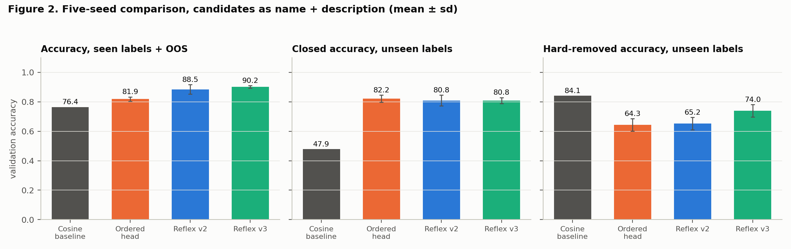
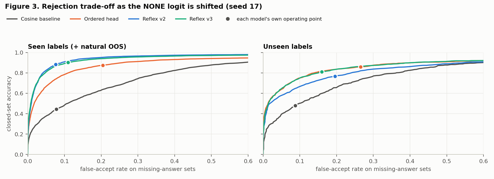
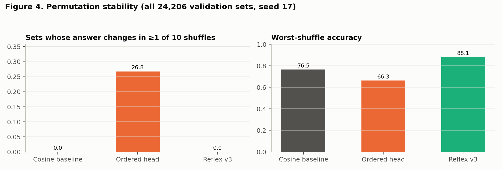
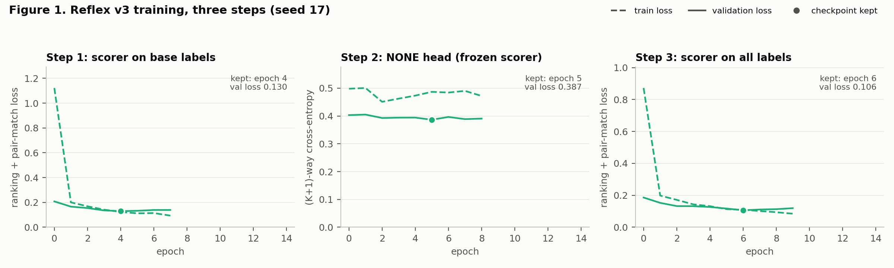

# Reflex v3 — Checkpoint Report

| | |
|---|---|
| Version | **v3** (frozen 2026-10-20); previous: [v2](../v2/REPORT.md), [v1](../v1/REPORT.md) |
| Code | git tag `v3` |
| Weights | `checkpoints/v3/weights/` (seed 17), SHA-256 in `MANIFEST.json` |
| Config | `checkpoints/v3/config.yaml` (`candidate_text: name_description`, plus five v3 keys) |
| Numbers | `checkpoints/v3/results/metrics.json`, regenerated by `python checkpoints/v3/analysis.py --seeds 17 18 19 20 21` |
| Encoder | `nvidia/Nemotron-3.5-Embed-1B-BF16`, revision `c0f2e8ab` (frozen, unchanged) |
| Evaluation split | **validation only.** The test split has still not been read. |

## Abstract

v3 keeps the v2 candidate scorer and changes only how `NONE_OF_THESE` is scored.
- **v2:** the NONE logit was computed from the query embedding and the candidate-set mean, and was trained jointly with the scorer on the 182 training labels.
- **v3:** NONE is still the (K+1)-th class of one softmax. Its logit now comes from a 129-parameter MLP over six order-free statistics of the candidate scores: top score, margin, normalized entropy, normalized log-sum-exp, maximum raw cosine and list size. The head never sees the query embedding.
- **How the NONE head is trained:** on a frozen scorer that never trained on 36 of the 182 training labels. These "pseudo-unseen" labels stand in for new labels, so the head learns what the scores look like when the gold label is unfamiliar. The scorer is then retrained on all 182 labels and the NONE head is reused unchanged.

Across five seeds, on the same validation sets as v1 and v2:
- **Rejecting sets whose gold is an unseen label and only similar options remain:** 65.2 ± 4.2% → **74.0 ± 4.2%** (+8.8 points). v3 is better on every seed, by +7.4 to +10.7.
- **AUROC, present vs hard-removed, unseen labels:** 84.1 → **86.6** (better on every seed). This is the best of the three learned heads (ordered: 85.0).
- **Accuracy, seen labels + out-of-scope:** 88.5 ± 3.2% → **90.2 ± 0.9%**. The seed spread is 3.5× smaller, and v3 is better on 4 of 5 seeds.
- **`NONE_OF_THESE` F1:** 91.3 → **92.7**.
- **Unseen-label trade-off (seed 17):** at a false-accept rate of at most 10%, v3 reaches 74.7% closed-set accuracy, against 66.1% for v2. This matches the ordered head (74.8%).
- **Order invariance:** still exact, with 0 answer flips in 242,060 shuffled evaluations.
- **Size:** 22% fewer parameters than v2 (2.29 M vs 2.95 M).

What v3 does not fix:
- **Closed-set accuracy on unseen labels is unchanged:** 80.8 ± 2.1 vs 80.8 ± 3.7 for v2. The ordered head is still ahead (82.2 ± 2.5).
- **Seed 17 is v3's second-worst run.** It scores 1.6 points below the seed-17 v2 model overall, although the five-seed mean is 1.7 points higher.

The development runs also give three negative results:
- the first v3 design, a projection matcher, generalizes poorly;
- a scorer without the set-mean summary loses 22 points on unseen hard-removed sets;
- a "novelty" input to the NONE head adds nothing.

## 1. What changed from v2

| | v2 | v3 |
|---|---|---|
| Candidate scorer | Deep Sets: shared MLP on [s, c, s⊙c, \|s−c\|] plus a set-mean summary | **unchanged architecture**, retrained with a new loss |
| Scorer loss | (K+1)-way cross-entropy, joint with NONE | ranking cross-entropy over candidates (gold-present sets only) + 1.0 × pair-match BCE on every real (query, candidate) pair |
| NONE logit | MLP over [projected query embedding, set-mean summary]; 656,129 parameters | MLP 6 → 16 → 1 over six statistics of the **detached** candidate scores; 129 parameters; never sees the query embedding |
| NONE training data | the scorer's sets, all 182 training labels | 120,000 balanced sets in which 36 training labels act as unseen labels, on a frozen scorer that never trained on them |
| Training | one stage | three steps (§3.3) |
| Parameters | 2,950,914 | 2,294,914 |

**Unchanged from v2:**
- data, splits and the 45 real unseen labels;
- validation and test candidate sets (identical files), and the candidate text (name + description);
- encoder, optimizer, learning rate, batch size, epochs, early stopping;
- seeds, temperature scaling and metrics.

**Code changes:**
- `ReflexRankingHead` in `src/models.py`.
- In `src/train.py`: `scorer_loss`, `train_reflex_v3`, and a `--heads` option. `--heads set_head ordered_head` reproduces the v2 training logs exactly.
- Three new outputs from `src/build_candidates.py`: `v3_split.json`, `v3_stage1.parquet` and `v3_stage2.parquet`. The train, validation and test files are unchanged.
- `rejection_tradeoff` in `src/evaluation.py`.
- Five new keys in `config.yaml`.
- Tests: 15 (v2: 10).

## 2. Claims and status

| # | Claim | v2 status | v3 evidence (five-seed mean ± sd unless noted) | v3 status |
|---|---|---|---|---|
| C1 | Reflex's decision does not depend on candidate order | Supported | 0 flips in 242,060 shuffled evaluations; probability change 0.000 to three decimals (seed 17); trained-head invariance test passes | **Supported** |
| C2 | An order-sensitive selector is unstable under shuffling | Supported | Ordered head: 26.8% of sets flip in ≥1 of 10 shuffles; worst-shuffle accuracy −15.0 points (seed 17) | **Supported** |
| C3 | Reflex selects more accurately than the baselines (seen labels) | Supported | 90.2 ± 0.9 vs 81.9 ± 1.5 (ordered) vs 76.4 (cosine) | **Supported** |
| C4 | Reflex rejects incomplete option sets | Partially, improved | NONE F1 92.7 ± 0.7; unseen hard-removed 74.0 ± 4.2 (v2: 65.2), still below cosine (84.1), which rejects more than half of all closed sets | **Partially supported, improved** |
| C5 | Reflex generalizes to labels never seen in training | Not supported; gap narrowed | Unseen closed 80.8 ± 2.1 (v2: 80.8; ordered: 82.2); unseen ranking 93.6 vs 95.2 (cosine) | **Not supported; unchanged** |
| C6 | Calibrated enough to route uncertain cases to an LLM | Prerequisite met | ECE 0.011 after temperature scaling (seed 17); routing untested | **Prerequisite met** |
| C7 | Reflex is as stable across seeds as the ordered head | Not supported (sd 3.2 vs 1.5) | Accuracy sd 0.9 vs 1.5 (ordered); worst seed 89.4 (v2: 83.2) | **Supported (new)** |
| C8 | A NONE head trained on simulated unseen labels transfers to real unseen labels | — | Unseen hard-removed +8.8 and AUROC +2.5 over v2, both on 5 of 5 seeds; unseen trade-off curve above v2's (§4.8); unseen closed accuracy unchanged | **Supported for rejection; not for selection** |

## 3. Method

### 3.1 Idea

A NONE decision should depend on **how well the offered options fit**, not on what the query looks like. v2's NONE logit read the query embedding directly, and was trained only on labels the scorer had memorized. It could therefore learn a pattern that holds for familiar labels but not for new ones.

v3 restricts NONE to the evidence in the candidate scores, and trains it where that evidence looks the way it will for new labels: on a scorer that has never seen the gold label.

### 3.2 Simulated unseen labels

`split_v3` in `src/build_candidates.py` draws a fixed split of the training labels once, with seed 17:

| | CLINC150 | BANKING77 | Total |
|---|---|---|---|
| Training (seen) labels | 120 | 62 | 182 |
| → base labels (scorer, step 1) | 96 | 50 | **146** |
| → pseudo-unseen labels (NONE head, step 2) | 24 | 12 | **36** |
| Real unseen labels (never used for training or selection) | 30 | 15 | 45 |

- **Held-out texts:** 15% of each base label's training texts (**2,290** texts) are kept from the step-1 scorer. Step 2 uses them as "seen" queries, so the NONE head learns from scores on texts the scorer did not fit.
- **What varies across seeds:** the five seeds change initialization and batch order only. The label split and all candidate sets stay fixed, as in v1 and v2.

### 3.3 Three training steps

1. **Scorer on base labels** (`v3_stage1`: 196,395 sets over 15 epochs, resampled per epoch like the v2 training sets).
   - **Data:** only base labels appear, as gold or as candidates. Held-out texts are excluded. CLINC150 out-of-scope texts are included as gold-missing sets.
   - **Loss:** ranking cross-entropy among the candidates on gold-present sets, plus μ × binary cross-entropy on every real (query, candidate) pair, with target 1 for the gold and 0 otherwise. μ = 1.
   - **Early stopping:** on validation rows with base labels or out-of-scope texts.
2. **NONE head on the frozen scorer** (`v3_stage2`: 120,000 sets).
   - **Groups:** 2,000 sets per epoch in each of four groups, {seen, pseudo-unseen query} × {gold present, gold removed}.
   - **Queries:** seen queries are the held-out texts; pseudo-unseen queries are the training texts of the pseudo-unseen labels.
   - **Candidates:** drawn from base and pseudo-unseen labels, half of them as hard negatives. Every set holds at least one pseudo-unseen candidate (a wrong one unless it is the gold), so an unfamiliar option never signals NONE by itself.
   - **Training:** (K+1)-way cross-entropy; only the 129 NONE-head parameters train.
3. **Scorer on all 182 training labels.**
   - **Training:** a fresh scorer is trained on the v2 training sets with the step-1 loss.
   - **NONE head:** copied in from step 2 unchanged.
   - **Calibration:** the temperature is then fitted on validation as for every other head.

**Why pair-match.** Ranking cross-entropy fixes only the differences between scores within one set. The NONE features read absolute score levels: top score, log-sum-exp. The pair-match term ties each score to the log-odds that the pair matches, so a given score level means the same thing across sets and across the two independently trained scorers (steps 1 and 3). Without it the reused NONE head is miscalibrated, and in different directions on different seeds (§4.2).

### 3.4 NONE-head inputs

| Feature | Definition | What it measures |
|---|---|---|
| top1 | largest candidate logit | how well the best option fits |
| top1 − top2 | margin between the two best logits | whether one option clearly wins |
| normalized entropy | H(softmax(z)) / log K, temperature 1 | how spread the evidence is |
| normalized log-sum-exp | logsumexp(z) − log K | total match evidence, comparable across K |
| max cosine | max over candidates of cos(query, candidate) from the frozen encoder | evidence independent of the learned scorer |
| log(1 + K) | list size | 5- vs 10-option sets |

- **Invariance:** every feature is a symmetric function of the candidate set, so invariance is preserved.
- **No gradient into the scorer:** the scores are detached before the NONE head, so the NONE loss never trains the scorer (unit-tested).

## 4. Results (validation)

All numbers are on the same 24,206 validation candidate sets as v1 and v2.
- **"All"** means the 19,370 seen-label and out-of-scope sets.
- **"Unseen"** rows come from 806 texts whose gold label was held out of training.
- **Seed-17 tables:** Cosine, Ordered and Reflex v2 are the frozen v2 checkpoint models (same candidate text); Reflex v3 is the frozen v3 checkpoint.

### 4.1 Five-seed comparison

Seeds 17–21, mean ± sd, in %. The v2, ordered and cosine runs are taken from `checkpoints/v2/results/metrics.json` (same data and protocol). Cosine has no seed dependence.

| Metric | Cosine | Ordered | Reflex v2 | **Reflex v3** |
|---|---|---|---|---|
| Accuracy, all | 76.4 | 81.9 ± 1.5 | 88.5 ± 3.2 | **90.2 ± 0.9** |
| Closed, seen | 44.5 | 82.0 ± 3.3 | 89.9 ± 1.8 | **90.1 ± 1.9** |
| Closed, unseen | 47.9 | **82.2 ± 2.5** | 80.8 ± 3.7 | 80.8 ± 2.1 |
| Hard-removed, unseen | **84.1** | 64.3 ± 4.2 | 65.2 ± 4.2 | 74.0 ± 4.2 |
| Gold ranked first, unseen | **95.2** | 92.6 ± 1.3 | 93.3 ± 0.6 | 93.6 ± 0.1 |
| AUROC hard-removed, unseen ×100 | 73.2 | 85.0 ± 0.9 | 84.1 ± 1.6 | **86.6 ± 0.7** |
| NONE F1 | 84.1 | 86.3 ± 1.2 | 91.3 ± 2.7 | **92.7 ± 0.7** |



**v3 minus v2, seed by seed** (in points). The same seed gives both models the same initialization seed and batch order, but they are different models, so this is a win count, not a paired test.

| Metric | 17 | 18 | 19 | 20 | 21 | Mean | Seeds where v3 is better |
|---|---|---|---|---|---|---|---|
| Accuracy, all | −1.6 | +1.1 | +6.8 | +0.7 | +1.6 | **+1.7** | 4 / 5 |
| Closed, unseen | +4.3 | +0.9 | −4.5 | −0.2 | −0.6 | 0.0 | 2 / 5 |
| Hard-removed, unseen | +7.4 | +10.7 | +9.9 | +7.4 | +8.7 | **+8.8** | **5 / 5** |
| AUROC hard-removed, unseen ×100 | +5.3 | +3.5 | +0.3 | +2.3 | +1.1 | **+2.5** | **5 / 5** |
| NONE F1 | −1.4 | +0.9 | +5.7 | +0.6 | +1.2 | **+1.4** | 4 / 5 |

Per seed, Reflex v3 accuracy on all sets is 89.4, 91.1, 90.0, 91.2, 89.5. Closed accuracy on unseen labels is 81.0, 80.2, 80.2, 78.6, 84.2, and hard-removed accuracy on unseen labels is 75.0, 77.4, 75.0, 75.9, 66.6.

### 4.2 Ablations: pair-match and retraining

Five seeds, mean ± sd, in %. "Not retrained" stops after step 2: the scorer has seen only the 146 base labels.

| Variant | Accuracy, all | Closed, seen | Closed, unseen | Hard-removed, unseen | Gold ranked first, unseen | AUROC hard-removed, unseen ×100 | NONE F1 |
|---|---|---|---|---|---|---|---|
| **v3** (pair-match on, retrained) | **90.2 ± 0.9** | **90.1 ± 1.9** | **80.8 ± 2.1** | 74.0 ± 4.2 | **93.6 ± 0.1** | **86.6 ± 0.7** | **92.7 ± 0.7** |
| v3, scorer not retrained | 86.3 ± 0.7 | 86.8 ± 0.9 | 80.6 ± 0.7 | 72.3 ± 2.2 | 92.9 ± 0.6 | 86.0 ± 0.9 | 89.6 ± 0.6 |
| v3, pair-match off | 79.2 ± 15.3 | 77.7 ± 12.8 | 68.3 ± 13.7 | 73.3 ± 32.6 | 92.9 ± 0.7 | 80.5 ± 4.1 | 81.0 ± 19.8 |
| v3, pair-match off, not retrained | 84.1 ± 0.7 | 82.2 ± 3.1 | 74.6 ± 5.0 | 76.9 ± 3.5 | 92.7 ± 0.8 | 83.3 ± 2.0 | 87.8 ± 0.7 |

- **Retraining on all labels (step 3) adds 3.9 points overall** (86.3 → 90.2). Most of the gain is on seen labels (closed 86.8 → 90.1), because the step-1 scorer never trained on 36 of them. Unseen closed accuracy barely moves (80.6 → 80.8).
- **The NONE head transfers to the retrained scorer only with pair-match.**
  - Without pair-match, the not-retrained model is reasonable (84.1 ± 0.7), but the retrained one is unstable (79.2 ± 15.3).
  - On seed 18 it almost never rejects: overall accuracy falls to 51.9%, and unseen hard-removed accuracy to 15.9%.
  - On the other four seeds it rejects too often: seen closed accuracy 62.7–81.7%.
  - The step-3 scorer's score scale differs from step 1's, and the NONE head reads absolute levels.
- **Pair-match also helps on its own:** without retraining, it raises unseen closed accuracy from 74.6 to 80.6 and AUROC from 83.3 to 86.0.

### 4.3 Development arms (negative results)

Before the final design, five other arms were run for five seeds each. The intermediate code is not in the repository; only the final arm survives as `ReflexRankingHead`. Their numbers are recorded in `results/development_runs.json`. The final arm's development runs match the `analysis.py` rerun exactly on all five seeds.

| Arm | Scorer | NONE inputs |
|---|---|---|
| projection matcher (first v3 run) | z = MLP([q⊙c, \|q−c\|, cos(q, c)]) on learned 2048→256 normalized projections; no set summary | six features |
| pairwise | z = MLP([s, c, s⊙c, \|s−c\|, cos(s, c)]) on raw embeddings; no set summary | six features |
| + novelty | as the arm it extends | six features + 1 − max cosine between the top candidate and the scorer's training labels |
| **v2 scorer (final v3)** | v2 Deep Sets scorer | six features |

All arms use the same three steps and data. Final (retrained) models, mean ± sd over five seeds, in %:

| Arm | Accuracy, all | Closed, seen | Closed, unseen | Hard-removed, unseen | Gold ranked first, unseen | AUROC hard-removed, unseen ×100 | NONE F1 |
|---|---|---|---|---|---|---|---|
| projection matcher, pair-match off | 74.7 ± 18.6 | 92.9 ± 6.2 | 62.5 ± 17.2 | 50.8 ± 28.4 | 86.4 ± 1.2 | 67.0 ± 5.4 | 73.7 ± 26.9 |
| projection matcher, pair-match on | 89.6 ± 2.6 | **96.1 ± 1.4** | 70.8 ± 6.7 | 46.6 ± 6.4 | 90.1 ± 0.7 | 68.9 ± 3.6 | 91.8 ± 2.3 |
| pairwise + novelty | 88.2 ± 0.7 | 88.7 ± 3.7 | 80.1 ± 3.9 | 52.9 ± 6.4 | 93.3 ± 0.1 | 79.6 ± 1.4 | 91.1 ± 0.7 |
| pairwise | 87.9 ± 0.6 | 90.9 ± 2.4 | **82.3 ± 2.4** | 51.8 ± 7.5 | 93.3 ± 0.1 | 80.9 ± 0.9 | 90.7 ± 0.6 |
| v2 scorer + novelty | **90.3 ± 0.9** | 90.2 ± 1.3 | 81.4 ± 1.6 | **74.3 ± 2.9** | **93.6 ± 0.1** | **87.0 ± 0.6** | **92.7 ± 0.7** |
| **v2 scorer (final v3)** | 90.2 ± 0.9 | 90.1 ± 1.9 | 80.8 ± 2.1 | 74.0 ± 4.2 | **93.6 ± 0.1** | 86.6 ± 0.7 | **92.7 ± 0.7** |

- **The projection matcher overfits the training labels.** It has the best seen closed accuracy (96.1%) but the worst unseen numbers: closed 70.8%, hard-removed 46.6%, AUROC 0.689. The learned 256-d projections fit the 182 training labels rather than the encoder's general geometry.
- **The set-mean summary matters for rejection.** The pairwise scorer, which drops it, is level with v3 on unseen closed sets (82.3 vs 80.8) and ranking (93.3 vs 93.6). It loses **22 points on unseen hard-removed sets** (51.8 vs 74.0) and 5.7 AUROC points. Without the summary, similar-but-wrong candidates score like the gold.
- **Novelty adds nothing measurable.** Paired over the five seeds (v2 scorer + novelty minus v2 scorer):

  | | Accuracy, all | Closed, unseen | Hard-removed, unseen | AUROC ×100 | NONE F1 |
  |---|---|---|---|---|---|
  | Mean difference | +0.0 | +0.6 | +0.3 | +0.4 | +0.0 |
  | sd of difference | 0.5 | 0.7 | 1.8 | 0.3 | 0.4 |

  It also makes the model depend on a stored bank of training labels. It was removed.

### 4.4 Do pseudo-unseen labels behave like real unseen labels?

The step-2 model's scorer never trained on the 36 pseudo-unseen labels, so their validation rows are a second, simulated unseen-label test. Five-seed means, in %:

| Model | Labels | Closed accuracy | Hard-removed accuracy | Gold ranked first |
|---|---|---|---|---|
| scorer on base labels (after steps 1–2) | base | 89.6 ± 1.1 | 79.5 ± 1.5 | 97.6 ± 0.2 |
| scorer on base labels (after steps 1–2) | pseudo-unseen | 75.9 ± 1.1 | 82.5 ± 2.1 | 92.3 ± 0.7 |
| scorer on base labels (after steps 1–2) | real unseen | 80.6 ± 0.7 | 72.3 ± 2.2 | 92.9 ± 0.6 |
| final v3 (after step 3) | base | 89.8 ± 1.8 | 84.9 ± 2.7 | 97.9 ± 0.1 |
| final v3 (after step 3) | pseudo-unseen (now trained on) | 91.3 ± 2.5 | 90.1 ± 2.9 | 98.6 ± 0.4 |
| final v3 (after step 3) | real unseen | 80.8 ± 2.1 | 74.0 ± 4.2 | 93.6 ± 0.1 |

- **Ranking matches:** gold ranked first 92.3% (pseudo) vs 92.9% (real).
- **Closed accuracy is slightly pessimistic:** 75.9 vs 80.6.
- **Rejection is optimistic by 10 points:** hard-removed 82.5 vs 72.3. The NONE head trained on these labels' training texts in step 2, so their validation rows are not new to it.
- **The pseudo split ranks the development arms like the real unseen labels.** Closed accuracy after step 2, five-seed means, in %:

  | Arm | Pseudo-unseen | Real unseen |
  |---|---|---|
  | projection matcher, pair-match off | 46.6 | 57.6 |
  | projection matcher, pair-match on | 47.5 | 65.4 |
  | pairwise + novelty | 70.4 | 76.6 |
  | pairwise | 72.4 | 78.4 |
  | v2 scorer (final v3) | 75.9 | 80.6 |
  | v2 scorer + novelty | 76.2 | 81.0 |

  The order is identical. Selecting an arm on pseudo-unseen labels, which are training labels, would have picked the same design without touching the real unseen labels.

After step 3 the pseudo-unseen labels are ordinary training labels (91.3% closed), so they no longer serve as a check.

### 4.5 Main results (seed 17)

Accuracy in % with 95% cluster-bootstrap CI, seen labels plus natural out-of-scope.

| Set type | n sets | Cosine | Ordered | Reflex v2 | **Reflex v3** |
|---|---|---|---|---|---|
| closed | 6,390 | 44.5 [42.7, 46.1] | 87.5 [86.6, 88.4] | 88.3 [87.2, 89.3] | **90.2** [89.3, 91.1] |
| gold_removed_hard | 6,390 | 86.4 [85.2, 87.5] | 68.9 [67.4, 70.4] | **87.7** [86.6, 88.8] | 84.4 [83.2, 85.5] |
| gold_removed_random | 6,390 | **97.8** [97.4, 98.1] | 89.7 [88.9, 90.4] | 96.9 [96.5, 97.3] | 93.4 [92.8, 94.0] |
| natural_oos | 200 | **100.0** [100.0, 100.0] | 98.0 [96.0, 99.5] | 98.0 [96.0, 99.5] | 98.0 [96.0, 99.5] |
| **all** | 19,370 | 76.4 [75.8, 77.0] | 82.2 [81.5, 82.8] | **91.0** [90.5, 91.5] | 89.4 [88.9, 89.9] |

Paired differences for Reflex v3 on identical sets, in points with 95% CI. All nine CIs exclude zero.

| v3 minus | All (seen + OOS) | Closed, unseen | Hard-removed, unseen |
|---|---|---|---|
| Reflex v2 | −1.6 [−2.1, −1.2] | +4.3 [2.7, 6.1] | +7.4 [5.2, 9.6] |
| Ordered | +7.2 [6.7, 7.8] | −4.9 [−6.7, −3.3] | +16.2 [13.7, 18.7] |
| Cosine | +13.0 [12.3, 13.6] | +33.1 [30.1, 36.0] | −9.1 [−12.0, −6.1] |

**Seed 17 understates v3 against v2.** v2's seed-17 model was its best draw (91.0, against a mean of 88.5), while v3's is its second worst (89.4, against 90.2). At seed 17, v3 is ahead of v2 on seen closed sets (+1.9) and on both unseen columns. It rejects seen-label incomplete sets less often: hard-removed 84.4 vs 87.7, random-removed 93.4 vs 96.9. Five-seed means (§4.1) are the numbers to quote.

### 4.6 Rejecting incomplete option sets (`NONE_OF_THESE`), seed 17, %

| | Cosine | Ordered | Reflex v2 | **Reflex v3** |
|---|---|---|---|---|
| Precision | 77.3 | 93.9 | 94.5 | **95.3** |
| Recall | 92.2 | 79.5 | **92.4** | 89.0 |
| F1 | 84.1 | 86.1 | **93.4** | 92.0 |
| False-accept rate | 7.8 | 20.4 | **7.6** | 10.9 |
| Closed-set errors that are false rejections | 98.9 | 84.2 | 93.6 | 91.6 |

At seed 17, v3 sits at a slightly more accepting operating point than v2 on seen labels. Across seeds its NONE F1 is higher (92.7 ± 0.7 vs 91.3 ± 2.7).

### 4.7 Labels never seen in training

Accuracy in %, seed 17, 95% CI.

| Set type | Labels | Cosine | Ordered | Reflex v2 | **Reflex v3** |
|---|---|---|---|---|---|
| closed | seen | 44.5 [42.7, 46.1] | 87.5 [86.6, 88.4] | 88.3 [87.2, 89.3] | **90.2** [89.3, 91.1] |
| closed | unseen | 47.9 [44.6, 51.4] | **85.9** [83.6, 88.1] | 76.7 [73.6, 79.3] | 81.0 [78.3, 83.5] |
| gold_removed_hard | seen | 86.4 [85.2, 87.5] | 68.9 [67.4, 70.4] | **87.7** [86.6, 88.8] | 84.4 [83.2, 85.5] |
| gold_removed_hard | unseen | **84.1** [81.7, 86.5] | 58.8 [55.7, 61.9] | 67.6 [64.4, 70.7] | 75.0 [72.4, 77.7] |
| gold_removed_random | seen | **97.8** [97.4, 98.1] | 89.7 [88.9, 90.4] | 96.9 [96.5, 97.3] | 93.4 [92.8, 94.0] |
| gold_removed_random | unseen | **98.5** [97.8, 99.1] | 88.1 [86.5, 90.0] | 93.2 [92.1, 94.5] | 93.0 [91.7, 94.2] |

**Average calibrated probability that a listed option is correct**, 1 − P(NONE):

| Set type | Labels | Cosine | Ordered | Reflex v2 | **Reflex v3** |
|---|---|---|---|---|---|
| closed (should be high) | seen | 0.485 | 0.873 | 0.853 | 0.874 |
| closed (should be high) | unseen | 0.500 | 0.867 | 0.770 | 0.803 |
| gold_removed_hard (should be low) | seen | 0.304 | 0.422 | 0.186 | 0.235 |
| gold_removed_hard (should be low) | unseen | 0.330 | 0.505 | 0.389 | 0.314 |
| gold_removed_random (should be low) | seen | 0.123 | 0.205 | 0.065 | 0.119 |
| gold_removed_random (should be low) | unseen | 0.116 | 0.220 | 0.109 | 0.128 |

- **Unseen labels now separate in both directions.** v3 is more confident than v2 on unseen closed sets (0.803 vs 0.770) and less confident on unseen hard-removed sets (0.314 vs 0.389).
- **Seen-label gap narrowed:** the gap in closed-set confidence between seen and unseen labels shrinks from 0.083 (v2) to 0.071.
- **Errors:** Reflex v3 errs on 306 of 1,612 unseen closed sets (v2: 376; ordered: 227). Of those errors, 93.8% are false rejections and 6.2% are wrong labels.

### 4.8 Rejection trade-off

Adding a constant to the NONE logit moves the operating point without changing which candidate ranks first. Sweeping the constant traces every trade-off that a rejection threshold could reach.
- **x-axis:** the share of missing-answer sets on which a listed option is still chosen (false accepts). For seen labels these are hard-removed, random-removed and natural out-of-scope sets; for unseen labels, hard- and random-removed sets.
- **y-axis:** closed-set accuracy.
- **Dot:** each model's own operating point (shift 0).



Seed 17, in %:

| Labels | Metric | Cosine | Ordered | Reflex v2 | **Reflex v3** |
|---|---|---|---|---|---|
| seen | operating point: false accept / closed accuracy | 7.8 / 44.5 | 20.4 / 87.5 | 7.6 / 88.3 | 10.9 / 90.2 |
| seen | closed accuracy at false accept ≤ 5% | 37.6 | 65.9 | **82.1** | 80.8 |
| seen | closed accuracy at false accept ≤ 10% | 47.9 | 77.9 | **90.7** | 89.2 |
| seen | closed accuracy at false accept ≤ 20% | 62.7 | 87.3 | **95.0** | 93.9 |
| unseen | operating point: false accept / closed accuracy | 8.8 / 47.9 | 26.6 / 85.9 | 19.6 / 76.7 | 16.0 / 81.0 |
| unseen | closed accuracy at false accept ≤ 5% | 39.6 | 63.8 | 57.5 | **64.5** |
| unseen | closed accuracy at false accept ≤ 10% | 50.1 | **74.8** | 66.1 | 74.7 |
| unseen | closed accuracy at false accept ≤ 20% | 65.6 | **83.5** | 76.7 | **83.5** |

- **The unseen-label curve moved, not just the threshold.**
  - At false-accept budgets of 5, 10 and 20%, v3 is 7.0, 8.6 and 6.8 points more accurate on unseen closed sets than v2, and its curve lies above v2's across that range (Figure 3).
  - Its curve coincides with the ordered head's, whose higher unseen closed accuracy (85.9) comes from a looser operating point (26.6% false accepts).
- **On seen labels, v2's curve is 1.1–1.5 points above v3's.**

### 4.9 Threshold-free comparison (seed 17)

| Metric | Labels | Cosine | Ordered | Reflex v2 | **Reflex v3** |
|---|---|---|---|---|---|
| Gold ranked first, closed (%) | seen | 95.4 [94.8, 96.0] | 95.3 [94.8, 95.9] | **98.1** [97.8, 98.5] | 97.9 [97.5, 98.3] |
| Gold ranked first, closed (%) | unseen | **95.2** [93.9, 96.4] | 94.2 [92.8, 95.4] | 93.1 [91.4, 94.6] | 93.6 [92.1, 95.0] |
| AUROC, present vs hard-removed | seen | 0.740 | 0.897 | **0.947** | 0.945 |
| AUROC, present vs hard-removed | unseen | 0.732 | 0.864 | 0.821 | **0.873** |
| AUROC, present vs random-removed | seen | 0.893 | 0.962 | **0.983** | 0.975 |
| AUROC, present vs random-removed | unseen | 0.906 | **0.949** | 0.940 | 0.944 |

### 4.10 Permutation stability (all 24,206 validation sets, 10 shuffles, seed 17)

| | Cosine | Ordered | **Reflex v3** |
|---|---|---|---|
| Answer flip rate per shuffle (%) | 0.0 | 10.7 | **0.0** |
| Sets with ≥1 flip in 10 shuffles (%) | 0.0 | 26.8 | **0.0** |
| Accuracy, original order (%) | 76.5 | 81.3 | **88.1** |
| Worst-shuffle accuracy (%) | 76.5 | 66.3 | **88.1** |
| Max probability change, mean over sets | 0.000 | 0.195 | **0.000** |
| Max probability change, worst set | 0.000 | 0.944 | **0.000** |



The trained v3 head passes the invariance unit test: its scores, mapped back to candidate identities, change by less than 10⁻⁵ under shuffling.

### 4.11 Calibration (seed 17)

| | Cosine | Ordered | Reflex v2 | **Reflex v3** |
|---|---|---|---|---|
| Temperature | 0.071 | 0.955 | 1.479 | 0.813 |
| NLL before → after | 1.853 → 0.657 | 0.511 → 0.510 | 0.282 → **0.254** | 0.304 → 0.296 |
| ECE after scaling | 0.072 | 0.043 | **0.010** | 0.011 |

v3's temperature is below 1, so its raw softmax is slightly under-confident, while v2's (above 1) was over-confident. A plausible but untested cause is that pair-match pulls the scores toward per-pair log-odds rather than softmax margins.

### 4.12 By dataset and list size

Accuracy in %, seed 17, seen labels plus natural out-of-scope.

| Subset | Cosine | Ordered | Reflex v2 | **Reflex v3** |
|---|---|---|---|---|
| CLINC150, all types | 77.3 | 84.1 | **91.1** | 89.7 |
| CLINC150 closed | 38.0 | 89.0 | 88.6 | **90.7** |
| CLINC150 gold_removed_hard | **93.2** | 69.6 | 87.0 | 83.1 |
| CLINC150 gold_removed_random | **99.6** | 93.2 | 97.5 | 94.9 |
| BANKING77, all types | 73.9 | 76.1 | **90.7** | 88.6 |
| BANKING77 closed | 64.0 | 82.9 | 87.3 | **88.5** |
| BANKING77 gold_removed_hard | 65.6 | 66.7 | **89.9** | 88.3 |
| BANKING77 gold_removed_random | 92.2 | 78.8 | **94.9** | 89.0 |
| 5 candidates | 76.9 | 84.3 | **92.2** | 91.8 |
| 10 candidates | 76.0 | 80.0 | **89.8** | 87.0 |

### 4.13 Training dynamics



- **Step 1 (scorer on base labels).**
  - Training loss falls from 1.122 to 0.094.
  - Validation loss falls steadily to a minimum of **0.130 at epoch 4**; the gold is ranked first in 97.5% of base-label validation sets.
  - Early stopping ends training at epoch 7.
- **Step 2 (NONE head).**
  - Validation loss moves little, from 0.403 to a minimum of **0.387 at epoch 5** (validation accuracy 86.0%); early stopping ends training at epoch 8.
  - With six inputs and 129 parameters, the head is close to converged after one epoch.
  - Training loss (0.45–0.50) stays above validation loss because the training sets are harder: half have pseudo-unseen queries, and every set holds an unfamiliar candidate.
- **Step 3 (scorer on all labels).**
  - Training loss falls from 0.873 to 0.085.
  - Validation loss reaches a minimum of **0.106 at epoch 6** (gold ranked first 97.9%); early stopping ends training at epoch 9.
- **No early swings.** v2's validation loss swung over its first epochs (0.48 → 0.69 → 0.40 → 0.59). In steps 1 and 3, validation loss falls at every epoch up to the minimum. The step-1 and step-3 losses are ranking + pair-match, so their values are not comparable with v2's (K+1)-way loss.

## 5. Analysis

1. **The gain is in rejection on new labels, not in selection.**
   - **What improved:** unseen hard-removed accuracy rises 8.8 points and AUROC 2.5 points, on every seed.
   - **What did not:** unseen closed accuracy (80.8 vs 80.8) and unseen ranking (93.6 vs 93.3) are unchanged.
   - **Why that is expected:** the candidate scorer is v2's, so choosing among options was not expected to change. What changed is when the model answers NONE.
2. **The trade-off itself improved on unseen labels.**
   - **Unseen labels:** at false-accept budgets of 5–20%, v3's curve lies 6.8–8.6 points above v2's (§4.8), so this is not just a threshold shift.
   - **Seen labels:** v3 gives up 1.1–1.5 points.
   - **Against the ordered head:** v3 matches it on unseen labels. On seen labels it stays 6.6–14.9 points ahead at the same budgets, and it remains exactly order-invariant.
3. **Ranking evidence is enough to decide NONE.** A 129-parameter head over six numbers matches v2's 656,129-parameter NONE head on seen labels (AUROC 0.945 vs 0.947) and beats it on unseen labels (0.873 vs 0.821). The query embedding is not needed to decide whether an answer is present.
4. **Simulated unseen labels are a usable development signal.** They reproduce the ranking accuracy of real unseen labels and order the six development arms identically (§4.4). They overstate rejection, because the NONE head trains on their texts.
5. **v3 is much less seed-sensitive.**
   - **Spread:** accuracy sd falls from 3.2 to 0.9, below the ordered head's 1.5. v2's poor seed (19, 83.2%) has no v3 counterpart; v3's worst is 89.4%.
   - **Validation curves:** the early validation-loss swings of v1 and v2 are gone.
   - **Cause not isolated:** we did not test whether the steadier training comes from the ranking + pair-match loss or from separating NONE training from the scorer.
6. **The remaining unseen-label gap is on closed sets.**
   - **Size of the gap:** unseen closed accuracy is 80.8%, against 90.1% for seen labels.
   - **Kind of errors:** 93.8% of unseen closed errors are false rejections.
   - **Ranking is not the issue:** the gold is ranked first in 93.6% of these sets.
   - **Where the problem likely is:** the scorer's evidence is weaker for new labels than for familiar ones, and the NONE head reads weak evidence as a missing answer. This was not measured directly, but it points to the scorer rather than the NONE head.

## 6. Threats to validity and limitations

All v1 and v2 caveats still apply (see [v1 §6](../v1/REPORT.md), [v2 §6](../v2/REPORT.md)). In addition:
- **Closed-set accuracy on unseen labels is not improved.** C5 is still not supported, and the ordered head remains 1.4 points ahead on five-seed means.
- **Seed 17 is unrepresentative in v3's disfavour.** The frozen v3 weights score 1.6 [1.2, 2.1] points below the frozen v2 weights overall. The five-seed means favour v3 by 1.7 points, and v3 wins on 4 of 5 seeds. At seed 17, v3 also rejects seen-label incomplete sets less often than v2 (false-accept rate 10.9 vs 7.6%).
- **Selection on unseen-label validation rows.**
  - The choice among development arms looked at unseen-label validation numbers: keeping the v2 scorer, dropping novelty, keeping pair-match.
  - The pseudo-unseen check ranks the arms the same way (§4.4), so the choice did not depend on the real unseen labels. Still, the reported unseen numbers are not fully untouched by design decisions.
  - The test split is where v3 should be confirmed.
- **One label split.** The 36 pseudo-unseen labels and the 2,290 held-out texts were drawn once (seed 17). Variance over different splits is not measured.
- **Untuned settings.** μ = 1, the 20% pseudo-unseen fraction, the 15% held-out fraction, 2,000 sets per group and the 16-unit NONE layer were each set once.
- **Development arms are not reproducible from tag `v3`.** They ran on intermediate code, which was removed when the design was settled. Only the final arm is reproducible, and it reproduces exactly.
- **Test set.** It remains untouched. v1, v2 and v3 should be evaluated on it together, once, at the end.

## 7. Deviations from `reflex_model.md`

All v1 and v2 deviations apply (see [v1 §7](../v1/REPORT.md)). In addition:
- **NONE logit.** The spec computes `none_logit = none_output([state_projection, set_summary])`. v3 computes it from six order-free statistics of the candidate scores. NONE remains the (K+1)-th class of one softmax, and no position information is used.
- **Training.** The spec trains one head in one stage on the training labels. v3 trains in three steps and uses a pseudo-unseen split of the training labels to train the NONE head. Validation and test candidate sets are unchanged.

## 8. Reproducing v3

```bash
git checkout v3
python3.10 -m venv .venv && .venv/bin/pip install -r requirements.txt
python download_datasets.py && python download_model.py
python src/prepare_data.py --config config.yaml
python src/embed.py --config config.yaml
python src/build_candidates.py --config config.yaml           # adds v3_split.json, v3_stage1, v3_stage2; train/validation/test unchanged
python src/train.py --config config.yaml --heads reflex_v3    # reflex_v3.pt (step 3) and reflex_v3_base.pt (steps 1-2)
python -m pytest                                              # 15 tests
python checkpoints/v3/analysis.py --seeds 17 18 19 20 21      # needs the v2 weights in checkpoints/v2/weights/
```

`MANIFEST.json` records the SHA-256 of every input (including `v3_split.json` and both v3 candidate files), the config, the weights and the package versions.

## 9. Candidate directions for v4

Not yet decided.
1. **Raise the scorer's confidence on new labels.** Options include training it with several out-of-fold label splits, or scoring as frozen cosine plus a learned correction, so new labels are not scored systematically lower than familiar ones.
2. **Several pseudo-unseen splits.** k-fold over the training labels would give the NONE head more simulated new labels, and the proxy (§4.4) a variance estimate.
3. **Choose the operating point from the trade-off curve** (for example, a false-accept budget) instead of the softmax's default, when routing uncertain cases to an LLM.
4. **Evaluate v1–v3 on the test split once.**

## Appendix A. Per-epoch logs (seed 17)

Step 1, scorer on base labels (validation: base-label and out-of-scope rows):

| Epoch | Train loss | Val loss | Val gold ranked first |
|---|---|---|---|
| 0 | 1.122 | 0.208 | 0.961 |
| 1 | 0.200 | 0.166 | 0.970 |
| 2 | 0.169 | 0.155 | 0.972 |
| 3 | 0.141 | 0.135 | 0.973 |
| **4** | 0.123 | **0.130** | **0.975** |
| 5 | 0.112 | 0.132 | 0.975 |
| 6 | 0.114 | 0.139 | 0.973 |
| 7 | 0.094 | 0.139 | 0.976 |

Step 2, NONE head on the frozen step-1 scorer (validation: seen-label and out-of-scope rows):

| Epoch | Train loss | Val loss | Val accuracy |
|---|---|---|---|
| 0 | 0.498 | 0.403 | 0.851 |
| 1 | 0.501 | 0.405 | 0.851 |
| 2 | 0.451 | 0.393 | 0.857 |
| 3 | 0.463 | 0.394 | 0.856 |
| 4 | 0.473 | 0.394 | 0.857 |
| **5** | 0.487 | **0.387** | **0.860** |
| 6 | 0.484 | 0.397 | 0.859 |
| 7 | 0.490 | 0.389 | 0.861 |
| 8 | 0.472 | 0.391 | 0.860 |

Step 3, scorer on all training labels (validation: seen-label and out-of-scope rows):

| Epoch | Train loss | Val loss | Val gold ranked first |
|---|---|---|---|
| 0 | 0.873 | 0.186 | 0.966 |
| 1 | 0.198 | 0.153 | 0.972 |
| 2 | 0.171 | 0.133 | 0.975 |
| 3 | 0.143 | 0.132 | 0.973 |
| 4 | 0.132 | 0.127 | 0.975 |
| 5 | 0.113 | 0.117 | 0.977 |
| **6** | 0.110 | **0.106** | **0.979** |
| 7 | 0.101 | 0.111 | 0.977 |
| 8 | 0.094 | 0.113 | 0.979 |
| 9 | 0.085 | 0.119 | 0.978 |

## Appendix B. Checkpoint contents

```text
checkpoints/v3/
├── REPORT.md                   this document
├── MANIFEST.json               SHA-256 of inputs (incl. v3 split and candidate files), weights and config; environment
├── config.yaml                 exact configuration
├── analysis.py                 regenerates results/metrics.json, figures and MANIFEST.json
├── results/
│   ├── metrics.json            every number in §4–§5, with CIs, seed runs, ablations and summaries
│   ├── development_runs.json   the development arms of §4.3 (intermediate code, not reproducible from tag v3)
│   ├── training_log.json       per-epoch losses for the three steps (seed 17)
│   └── calibration.json        cosine threshold and temperatures
├── figures/                    fig1_training, fig2_comparison, fig3_tradeoff, fig4_permutation_stability
└── weights/                    reflex_v3.pt, reflex_v3_base.pt (not in git; hashes in MANIFEST.json)
```
