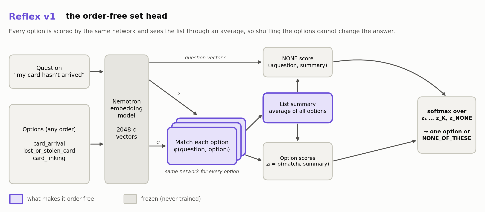
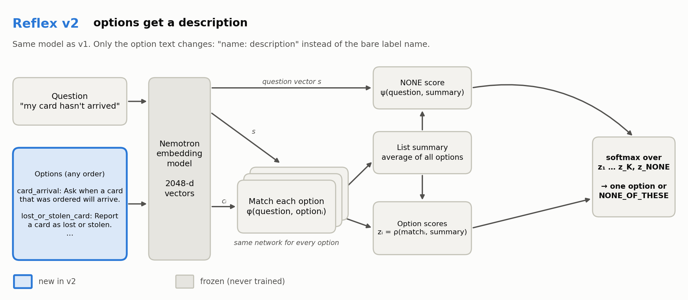
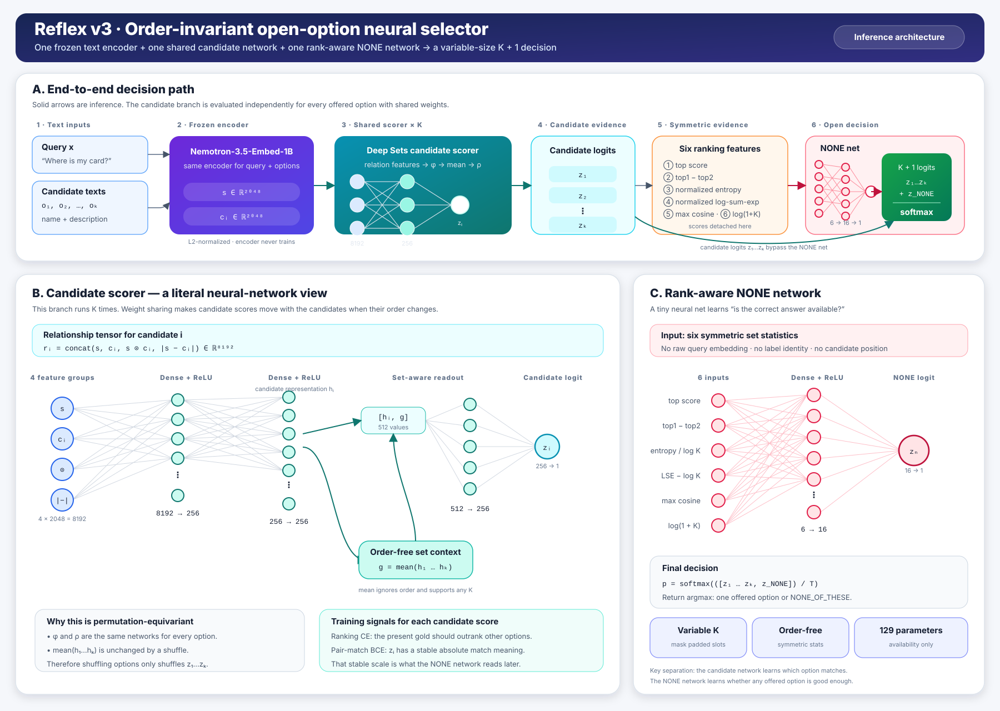
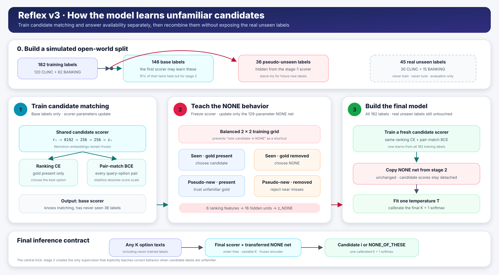

# Reflex

Reflex picks the right option from a list, or says that none of the options fits. It is
designed to be fast enough to run locally, to give the same answer however the list is ordered,
and to work with options it has never seen before.

This document explains what Reflex is for, how it is tested, and what each of its three versions
changed: what worked, and what didn't. Full numbers are in the checkpoint reports
([v1](checkpoints/v1/REPORT.md), [v2](checkpoints/v2/REPORT.md), [v3](checkpoints/v3/REPORT.md)).

## 1. Purpose

Many applications have to map a user's message to one of a few available actions:

```text
"I ordered a card two weeks ago and it still hasn't arrived"
    options: card_arrival · lost_or_stolen_card · activate_my_card · card_linking · getting_spare_card
    answer:  card_arrival
```

Doing this with a large language model works, but it is slow and costly per request. Small
learned selectors are fast, but they usually have two problems:

1. **They depend on the order of the options.** A model that reads options as "slot 1, slot 2,
   …" can change its answer when the same options are listed in a different order.
2. **They are forced to choose.** If the right action isn't in the list, they still pick one:

   ```text
   "set an alarm for 6 am tomorrow"
       options: timer · reminder · calendar · weather · time
       a forced-choice model has to pick one of these; the right answer is that none of them fits
   ```

Reflex is built to fix both:

- **Order-free by construction.** Every option is scored by the same network, and the options are
  summarized with an average, so shuffling the list cannot change the answer.
- **An explicit `NONE_OF_THESE` answer.** It competes with the options in the same softmax.
- **Open options.** Options are given as text, `name: description`, so new actions can be added
  without retraining. Since v2 the format is, for example,
  `card_arrival: Ask when a card that was ordered will arrive.`
- **Cheap.** A frozen embedding model (`nvidia/Nemotron-3.5-Embed-1B-BF16`) turns texts into
  vectors once, and a small head of about 2–3 M parameters makes the decision.

The intended use is a fast local first pass, with uncertain cases passed on to a bigger model.
That routing step is not built.

## 2. How Reflex is tested

**Data.** Two intent datasets: CLINC150 (150 intents across 10 domains, plus "out-of-scope"
messages) and BANKING77 (77 fine-grained banking intents).

**Unseen labels.** 20% of the labels (45 of 227) are held out of training completely. They only
appear at evaluation, to test whether Reflex handles options it has never seen.

**Four kinds of test sets**, each with 5 or 10 options:

| Set type | What it contains | Right answer |
|---|---|---|
| closed | the correct option plus random others | the correct option |
| gold removed, random | random options, correct one removed | `NONE_OF_THESE` |
| gold removed, hard | the options most similar to the correct one, correct one removed | `NONE_OF_THESE` |
| natural out-of-scope | a CLINC150 message that matches no intent | `NONE_OF_THESE` |

The hard sets are the difficult ones: "I want to cancel my transfer" offered with
`transfer_timing`, `pending_transfer` and `transfer_fee_charged`, but without `cancel_transfer`.

**Baselines,** all using the same embeddings and test sets:
- **Cosine:** pick the most similar option; answer `NONE_OF_THESE` if even the best one is below a
  tuned threshold.
- **Ordered head:** a learned selector that reads options in their list order (the
  order-sensitive comparison).

All results are on the validation split, as five-seed means. The test split has not been used.

## 3. The three versions at a glance

Five-seed means, in %. "Unseen" means the label was never seen in training.

| | v1 | v2 | v3 |
|---|---|---|---|
| **What changed** | first set head, options as label names | options as name + description | new way to decide `NONE_OF_THESE` |
| Accuracy (seen labels + out-of-scope) | 85.5 ± 3.7 | 88.5 ± 3.2 | **90.2 ± 0.9** |
| Correct answer present, unseen label | 77.1 | **80.8** | **80.8** |
| Hard set with answer missing, unseen label (rejected correctly) | 56.1 | 65.2 | **74.0** |
| Correct option ranked first, unseen label | 89.7 | 93.3 | **93.6** |
| `NONE_OF_THESE` F1 | 88.8 | 91.3 | **92.7** |
| Answer changes when the list is shuffled | **never** | **never** | **never** |
| Parameters | 2.95 M | 2.95 M | **2.29 M** |

For comparison, on v2/v3's option texts the ordered head reaches 81.9% accuracy and changes its
answer on 26.8% of sets within 10 shuffles. Cosine reaches 76.4%.

## 4. v1 — the order-free set head

### Idea

Score every option with the same small network, give every option a view of the whole list
through an average, and add a separate score for `NONE_OF_THESE`. Options are the raw label
names from the datasets, such as `card_arrival` or `pending_top_up`.

### Architecture



The purple parts make it order-free. In formulas:

```text
question ──► Nemotron (frozen) ──► s
option i ──► Nemotron (frozen) ──► cᵢ                       (i = 1 … K)

for every option, with the SAME network φ:
    hᵢ = φ( [ s, cᵢ, s⊙cᵢ, |s − cᵢ| ] )          how well does option i match the question?

m = mean(h₁ … h_K)                                summary of the whole list (order-free)

option score:   zᵢ     = ρ( [ hᵢ, m ] )            same network ρ for every option
NONE score:     z_NONE = ψ( [ project(s), m ] )    reads the question and the list summary

answer = softmax( z₁ … z_K , z_NONE )
```

Because φ and ρ are shared and m is an average, shuffling the options only shuffles their scores.

### What worked

- **Exact order invariance.** Across 242,060 shuffled evaluations, Reflex's answer never changed.
  The ordered head changed its answer on 29.9% of sets within 10 shuffles, and its worst-case
  accuracy fell from 77.9% to 61.7%.
- **Better than the baselines on known labels:** 85.5% accuracy, against 78.3% for the ordered
  head and 74.5% for cosine.
- **Rejecting incomplete lists:** best `NONE_OF_THESE` F1 (88.8), and well-calibrated
  probabilities.

### What didn't

- **New labels.** With a label it had never seen, Reflex answered correctly only 77.1% of the
  time, no better than the ordered head. It even ranked new labels worse than plain cosine
  similarity (89.7% vs 92.0%): it had partly memorized the 182 training labels.
- **Similar-but-wrong options.** When the right label was a new one and only similar labels were
  offered, Reflex rejected the list only 56.1% of the time. It was close to guessing.
- **Unstable between seeds:** ±3.7 points across training seeds.
- **Bare names are ambiguous.** `pending_top_up`, `top_up_failed` and `top_up_reverted` are hard
  to tell apart from their names alone, especially for a label the model never trained on.
- **The planned ordered baseline never learned.** It was specified as an MLP over the raw,
  concatenated embeddings. It predicted `NONE_OF_THESE` for every input, so it was replaced with a
  version that gets the same comparison features as Reflex.

## 5. v2 — options with descriptions

### Idea

Describe every option in one sentence, written from the label name only (no example messages
were used), and embed `"name: description"` instead of the bare name.

```text
v1:  card_arrival
v2:  card_arrival: Ask when a card that was ordered will arrive.

v1:  pending_card_payment
v2:  pending_card_payment: Ask why a card payment is still pending.
```

### Architecture

Unchanged from v1. Only the option text going into the encoder changed (blue):




```text
"name: description" ──► Nemotron (frozen) ──► cᵢ ──► same v1 set head
```

### What worked

Every method improved, and the gains were largest exactly where v1 was weakest:
- **New labels, answer present:** 77.1% → 80.8%.
- **New labels, hard set with the answer missing:** 56.1% → 65.2% rejected correctly (+9.0).
- **Ranking new labels:** 89.7% → 93.3%.
- **Overall:** accuracy 85.5% → 88.5%, `NONE_OF_THESE` F1 88.8 → 91.3, calibration error halved
  (ECE 0.019 → 0.010).

### What didn't

- **Still level with the ordered head on new labels** with the answer present (80.8% vs 82.2%).
- **Still seed-sensitive:** ±3.2 points, twice the ordered head's spread.
- **Most remaining errors on new labels were false rejections** (94%). Reflex usually ranked the
  right option first, but then answered `NONE_OF_THESE` anyway. Its NONE decision was learned
  only on labels it had memorized, so an unfamiliar correct option looked like a missing answer.

## 6. v3 — deciding `NONE_OF_THESE` from the evidence

### Idea

The NONE decision should depend only on **how well the options fit**, not on what the question
looks like. It should also be learned in a situation that looks like meeting new labels.

1. **Keep v2's option scorer.**
2. **Replace the NONE score** with a tiny network (129 parameters) that sees only six summary
   numbers about the option scores, never the question itself.
3. **Train the NONE head on simulated new labels.** 36 of the 182 training labels are hidden from
   the scorer and play the role of unseen labels, so the NONE head learns what the scores look
   like when the correct option is unfamiliar.

### Architecture



Compared with v2, the NONE score no longer reads the question vector itself
or the list summary. It only reads six numbers: five computed from the option scores, plus the best
raw cosine similarity between the question and an option. In formulas:

```text
question, options ──► v2 scorer (unchanged) ──► option scores z₁ … z_K
                                                    │
                                                    │ (no gradient flows back into the scorer)
                                                    ▼
          six numbers about the scores:
            best score · gap between best and second best · how spread the scores are
            total match evidence · best raw cosine similarity · number of options
                                                    │
                                                    ▼
                                tiny network 6 → 16 → 1 ──► z_NONE

answer = softmax( z₁ … z_K , z_NONE )
```

### Training in three steps



```text
182 training labels
 ├── 146 "base" labels ────► Step 1: train the scorer on base labels only
 │                                    (ranking loss + a per-option "does it match?" loss)
 └──  36 "pseudo-unseen" ──► Step 2: freeze the scorer; train the NONE head on lists
                                     that mix base and pseudo-unseen labels
all 182 labels ────────────► Step 3: train a fresh scorer on everything; reuse the step-2 NONE head

45 real unseen labels ─────► never used for training or model choice; evaluation only
```

The per-option "does it match?" loss (pair-match) gives scores the same meaning in every list and
in both scorers. Without it, the NONE head trained in step 2 doesn't fit the step-3 scorer.

### What worked

- **Rejecting similar-but-wrong options for new labels:** 65.2% → 74.0%, better on all 5 seeds.
  With the right option removed and only near misses offered, v3 usually says none fits:

  ```text
  "set an alarm for 6 am tomorrow"
      timer · reminder · calendar · weather · time     →  NONE_OF_THESE (p = 0.94)
  ```

- **Much more stable:** the spread across seeds fell from ±3.2 to ±0.9 points. Overall accuracy
  rose to 90.2%.
- **Smaller:** 129 parameters for the NONE decision instead of 656,129, and the whole head shrank by
  22%.
- **Works on a new domain.** On invented customer-service tools it never saw, it picks clearly
  described tools:

  ```text
  "There's a $49.99 charge on my statement I don't recognize"
      → dispute_charge (p = 0.99), out of 10 tools
  ```

### What didn't

- **New labels with the answer present did not improve** (80.8%, same as v2). The ordered head is
  still slightly ahead (82.2%). Reflex still rejects too often when the correct option is new, and
  close calls between the right option and `NONE_OF_THESE` remain:

  ```text
  "I ordered a new card two weeks ago and it still hasn't shown up"
      card_arrival 0.57 vs NONE_OF_THESE 0.43   (right, but only just)
  ```

- **Options that resemble training labels can be over-scored.** On the customer-service tools,
  `transaction_status` beat `order_tracking` for "Where is my package?", possibly because it
  resembles the banking labels seen in training.
- **Design variants that failed before the final v3:**

  | Variant | Result |
  |---|---|
  | Scorer with learned 2048 → 256 projections | memorized training labels: 96.1% on seen labels, 70.8% on new labels |
  | Scorer without the list average | rejection of similar-but-wrong options on new labels dropped to 51.8% |
  | Extra "how unfamiliar is this option" input to the NONE head | no measurable effect |
  | Training without the pair-match loss | unstable: on one seed accuracy collapsed to 51.9% |

- **Tried after v3 and removed:** adding plain cosine similarity under the learned scores, so
  new labels would start from cosine's better ranking. It improved known labels by 1.9 points, but
  made rejection on new labels worse (−3.9 points, 4 of 5 seeds). The learned part took over
  instead of staying close to cosine.

## 7. What is still open

- **New labels with the answer present (about 81%) are the main gap.** The model ranks the right
  option first about 94% of the time, but then often doubts it. The fix probably belongs in the
  scorer: more varied label descriptions during training, or adapting the encoder itself.
- **Routing to a bigger model** for uncertain cases is not built.
- **The test split** has not been used. v1–v3 should be evaluated on it together, once.

## 8. Where to find things

| What | Where |
|---|---|
| Full results, method details and limitations per version | `checkpoints/v1/REPORT.md`, `checkpoints/v2/REPORT.md`, `checkpoints/v3/REPORT.md` |
| Model code | `src/models.py` (`ReflexSetHead` = v1/v2, `ReflexRankingHead` = v3) |
| Scoring new questions and options | `src/predict.py`; see `examples/README.md` |
| Example requests | `examples/predict_requests.jsonl`, `examples/customer_service_tools.jsonl` |
| Architecture diagrams | `docs/figures/`: v1 and v2 PNGs (regenerate with `.venv/bin/python docs/make_diagrams.py`), v3 `reflex_v3_architecture.svg` and `reflex_v3_training.svg` |
| Original hackathon specification | earlier versions of this file in git history (`git show v3:reflex_model.md`); the reports' "Deviations from `reflex_model.md`" sections refer to it |
